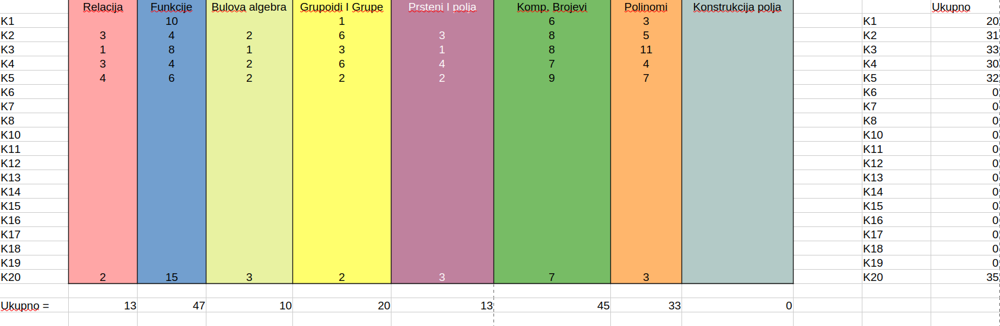

- Sav materijal koji sam koristio za spremanje kolokvijuma potiče iz knjige
- Tekst u knjizi sam izdovojio putem bojenja markerima, te uporedo dodavao ukoliko je bilo potrebe za razjašnjenem
- Iako ne savetujem da se uče samo određene lekcije, posmatrajući statistički prikaz, očevidno je da zadaci češće dolaze iz određenih oblasti
- Zadaci potiču iz knjige "Testovi iz algebre" Rade Doroslovački Ljubo Nedović 2021. izdanje
    
  
