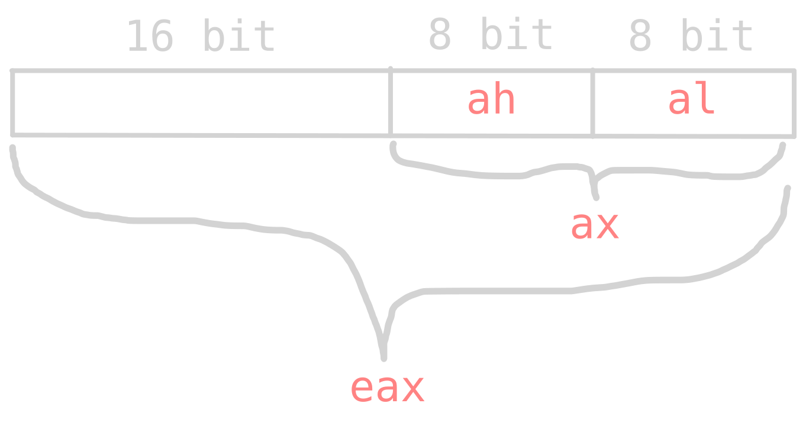
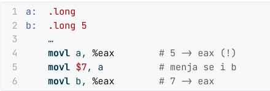
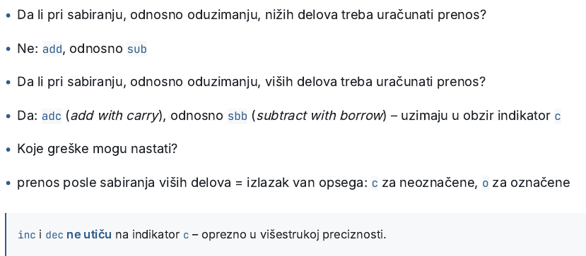
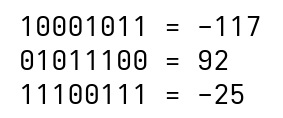
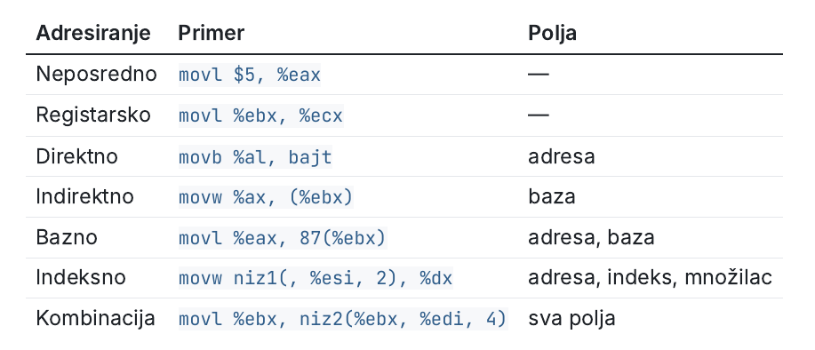
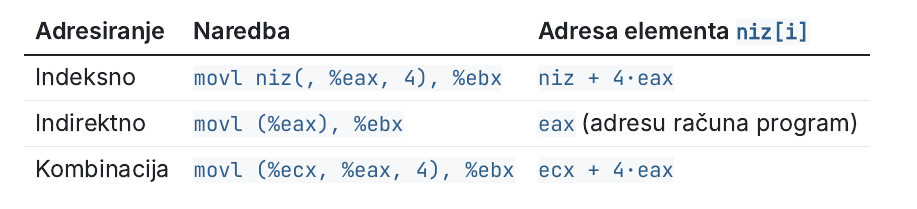
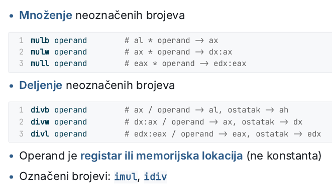
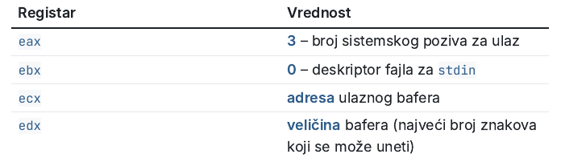
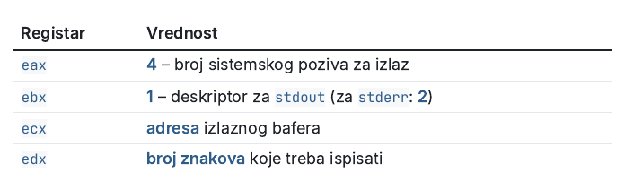
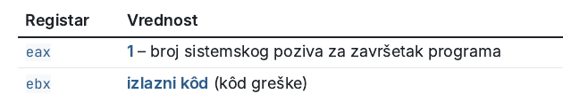

# V1
### Registri

- 32-bitni mikroprocesor ==LITTLE ENDIAN== 
	> prvo se upisuje bajt najniže vrednosti 
- Isti princip raspodele važi i za ebx, ecx, edx
- promena ax menja i eax, nije moguće koristiti oba istovremno 

### Zastavice

- ## ==🟡Procesor ne razlikuje označene i neoznačene brojeve==
> 11101001 može biti 213 ili -23 U ZAVISNOSTI KAKO MI GLEDAMO NA BROJEVE
- c (carry) - zastavica prekoračenja za unsigned brojeve
- o (overflow) -  zastavica za označene signed brojeve 
- z (zero) - da li je rezultat jednak nuli
- s (sign) - da li je najviši bit == 1
### AT&T sintaksa
- pristup registrima vrši se putem *%* prefiksa 
- neposredni operandi označeni su prefiksom *$*
- *b* - 8 bita
- *w*  - 16 bita
- *l* - 32 bita
- ## ==VREDNOST SE UVEK ČUVA U DESNOM OPERANDU==
-  gcc -m32 -g -o primer primer.c - komanda kompajliranje
### GDB: registri i zastavice
- layout reg 
- p $eax 
- p $eflags prikazuje zastavice
 > focus cmd / focus src prebacuje kontrolu sa koda na komandu liniju i obrnuto

# V2
#### Neoznačeni i označeni brojevi
- procesor jedino zaista poznaje cele brojeve
> da li je promenljiva označena ili neoznačena zavisi od programera
- CARRY - NEOZNAČENI
- OVERFLOW - OZNAČENI
- najviše jedan operand može biti pristupanje memoriji
> drugi može biti registar ili konstanta tipa $0x5

#### Definisanje numeričkih podataka
- primer: .word 0x153
> ime_labele: .veličina 0xvrednost
- .byte .word. .long .quad
- movl $primer, %eax bi prebacio adresu na koju pokazuje primer tipa 0x100
- movl primer, %eax bi prebacio vrednost "kutijice" tipa 0x5
#### Definisanje i upotreba konstanti
- const1 = 0x5 ili nesto = 0x20
- PAZI SAD OVO, vrednosti konstante mora da se pristupi sa $, dok je bez nje samo adresa
>  movl $const1+const2, %eax

#### Inicijalna vrednost promenljive
- neinicijalizovana promenljiva pokazuje na istu adresu kao naredna promenljiva

#### Prikaz u GDB-u
- *p/x* heksadecimalno
- *p/u* unsigned
- *p/d* signed
- *display* ispisuje nakon svakog koraka
- komanda tipa x/3xb $promenljiva prikazaće 3 bajta od promenljive u heksadecimalnom obliku
> 3 za koliko puta, x za heksadec, b za bajt 

#### Višestruka preciznost
- kada broj se ne može smestitit u 32-bitni registar, možemo ga smestiti putem korišćenja više njih, te tako što ćemo deo vrednosti smestiti u prvi registar, dok ćemo drugi u viši
- najčešće se koriste samo dvostruke preciznosti
#### Sabiranje u dvostrukoj preciznosti
- sabiraju se niži, te potom viši delovi

- addl dodaje bez da uračunava vrednost carry zastavice
- adcl doda vrednosti i doda jos carry zastavicu
- kompelement dvojke ukoliko je prvi bit 1 racuna kao negativan broj

- sabiranje negativnog i pozitivnog dela svodi se na to da je za pozitivni broj bit najveće vrednosti uvek 0, a ostali koji su 1 dodaju vrednost onom **pozitivnom delu**
- kada se pozitivni deo potom sabere i doda negativnom npr -128 to se negativni deo umanjuje
- KOMPJUTER NE RAZUME ODUZIMANJE
 
# V3
#### Načini adresiranja

 - **baza i indeks su registri opšte namene**
#### Indeksno 
 - `movl niz(, %eax, 4), %ebx` 
	  > kreće od adrese niza, pomeri se za %eax * 4 bajta i šta uzme prebaci u %ebx
#### Indirektno 
 - `movl $niz, %eax`
- `addl $8, %eax`
- `movl (%eax), %ebx`
> prebaci adresu niza u %eax, uveća eax za 8 bajtova i onda sa te adrese pročita 4 bajta i upiše u %ebx
#### Kombinacija
- `movl $niz, %ecx`
- `movl $2, %eax`
- `movl (%ecx, %eax, 4), %ebx`
> zadnja linija se prevodi na: kreni od vrednosti koju sadrži ecx, pomeri se za eax * 4 bajtova i upiši vrednost u ebx

- indeksno adresiranje radi samo za elemente do 8 bajtova
- za brže zauzimanje i popunjavanje memorije koristi se direktiva fill
> `niz1: .fill br_elem, br_bajt, poč_vredn`
> `niz2: .fill 10, 4, 0`

- operacije množenja koriste registarski par eax:edx za izvršavanje i čuvanje rezultata
- div daje izuzetak ako je delilac 0
- pre divl postaviti edx na 0 
# V4
- string ili niska je niz ASCII znakova od po 1 bajt sa poslednjim znakom "\0" koji označava kraj niza
-  definišu se direktivom .ascii
> `str: .ascii "Neki tekst\0"`
- tačka je brojač lokacija koja pokazuje na prvu slobodnu memorijsku lokaciju
- može se koristiti za izračunavanje dužine niske SAMO ODMAH NAKON DEFINISANJA NISKE
>  `str_len = . - str = 0x10b - 0x100 = 11`
- brojač . radi samo tokom prevođenja programa
- . se mogu odrediti samo dužine već unapred zadatih niski
- "\0" je $0
#### Sistemski pozivi
- omugućavaju pozivanje operacija **operativnog sistema**
- naredba za prekid je  ==int 0x80==
- parametri se prenose preko registra
- različiti pozivi uzimaju različite registre
- u eax se upisuje broj sistemskog poziva
- READ

- rezultat poziva se upisuje u eax
- **poziv read učitava %edx karaktera, read ne dodaje \0 na kraj niske**
- WRITE

- eax sadrži broj ispisanih znakova
- write ne prepoznaje \0 - ispisuje onoliko karaktera koja je vrednost edx
- EXIT
 
- naredba `lea` učitava adresu promenljive u registar
- adresa se računa dinamički, tj. u toku izvršavanja
> `lea str, %eax`
#### Česte greške
- prosleđivanje adrese bez $ što daje vrednost na koju pokazuje promenljiva
> `movl str, %eax` VS `movl $str, %eax`
- ne proveravanje vrednosti eax nakon izvršavanja funkcije
- korišćenje registra eax i ax istovremeno
- **UČITAVANJE ILI ISPIS VIŠE KARAKTERA OD POTREBNIH**
