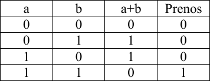
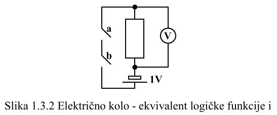
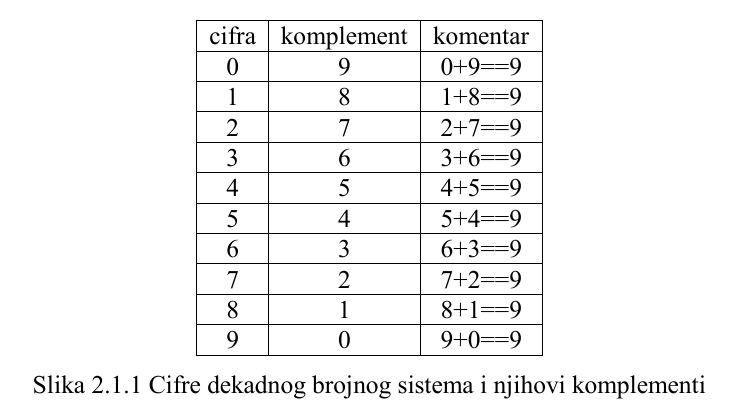

# Parcijalni 1
## 1. Uvod
### 1.1. Pojam arhitekture računara
- Arhitektura računara se bavi problemima upotrebe i pravljenja računara
- Način programiranja zavisi od osobina skupa naredbi računara
- Implementacija arhitekture naredbi obuhvata **organizaciju** i **izvedbu** računara
- Pojam arhitekture računara obuhvata arhitekturu naredbi i njenu implementaciju, jer su međusobno uslovljenje jedan drugom
### 1.2. Model računara
 Celi, realni, znakovni i logički skup podataka nazivaju se i **prosti tipovi**
> Napomena: zapravo, *u svetu računarstva*, ne postoji nijedan drugi skup podataka sem logičkih, tj. 0 i 1 kao vrednosti binarnog sistema. Svakom celom broji u nekakvoj predstavi postoji ekvivalent u binarnom cifarnom sistemu. Znakovi su zapravo kodirani celi brojevi koji ih po dogovoru jednoznačno predstavljaju. Realni brojevi su samo razlomljeni celi brojevi odvojeni tačkom. Svet je jedno okrutno mesto puno prevaranata :(
- Od prostih, tj. osnovnih tipova grade se svi ostali
- Opštost ili okvire daju promenljive, sa svojim tipovima i vrednostima, kao i upravljačke operacije koje se izvršavaju nad njima
- Osnovne elemente procedurnih programskih jezika predstavljaju promenljive, vrednosti prostih tipova i operacije
#### Memorija
- Memorija je sastavljena od niza lokacija
- Svaka lokacija poseduje numeričku oznaku koja je jednoznačno određuje i njoj odgovara
- Pored numeričkih, postoje i simboličke, kao što su labele
- Preko labele pristupamo memoriju umesto preko adrese
- Ključna osobina lokacija jeste da mogu sadržati različite tipove podataka bez ikakvih problema
- Problem koji nastaje je raspoznavanje i tumačenje vrednosti u odnosu na upisanog podatka
- U lokaciji može biti upisana isti podatak i da pritom po odlučenom dogovoru bude dozvoljeno posmatrati na dva ili više različita načina
 > Npr. tumačenje označenih i neoznačenih celih brojeva
- Nekoj lokaciji se pristupa ukoliko je neophodno upisati ili pročitati podatak sa te lokacije
#### Procesor
- Procesor je sastavljen od sklopova i registara
- Sklopovi omogućavaju izvršavanje pojedinih operacija
- Registri su lokacije u memoriji procesora koje sadrže vrednosti tokom obrade podataka, tj. izvršavanja operacija
- Registri nemaju numeričku, već jedinstvenu simboličku oznaku preko koje im se pristupa
- Registri se nalaze u procesoru
- Pre izvršavanja operacije, procesor uzima **oznaku operacije** i **njene operande**
- Oznaka operacije i operandi obrazuju **naredbu**
#### Adresiranje
- Operandi se dele na **ulazne** i **izlazne**
- **VAŽNO** ulazni operand svojim osobima (tip podatka i određeni opseg), jasno određuje kakve ulazne vrednosti su dozvoljene i iskoristljive
- **Pojašnjenje:** da bi dali odgovor na pitanje kakav je operand moramo da pogledamo koja ulazna vrednost je očekivana
> ukoliko traži konst. vredn. onda je neposredni, ukoliko traži da učita podatak iz registra onda je registarski itd.
- **VAŽNO:** Nije najjasnije razjašnjeno da operacije imaju izlaznu vrednost koja se razlikuje od izlaznog operanda. Izlazni operand predstavlja mesto gde treba upisati izlaznu vrednost operacije
##### Ulazni
- Neposredni - ulazna vredn. je neka konstanta npr. `72, 106, -301.41`
- Direktni - ulazna vredn. je memorijska lokacija sa koje treba pročitati podatak
- Registarski - ulazna vredn. je registar koji sadrži neophodan podatak
- Posredni - ulazna vredn. je registar koji sadrži mem. lokaciju sa koje treba pročitati podatak
-  Indeksni - ulazna vredn. je kombinacija indeksa i oznake registra; registar sadrži mem. lokaciju koja u sumi sa indeksom daje novu mem. lokaciju sa koje treba pročitati
##### Izlazni
- Direktni - operand sadrži memorijsku lokaciju na koju treba upisati podatak
- Registarski - operand je oznaka registra u koji treba upisati podatak
- Posredni - operand je oznaka registra, koji sadrži mem. lokaciju u koju treba upisati podatak
- Indeksni - operand je oznaka registra u komb. sa indeksom; registar sadrži mem. lokaciju koja sumirana sa indeksom daje novu mem. lokaciju u koju treba upisati podatak
##### Skup naredbi
- Skup naredbi procesora može se svesti na podskup aritmetičkih, kao i na relacione, logičke, upravljačke i naredbe prebacivanja
- Najvažnije aritmentičke naredbe jesu celobrojno sabiranje i oduzimanje; preko njih možemo izvesti sve ostale 
- Logičke naredne obuhvataju logičko *I, ILI i NE*
- Upravljačke bezuslovnu ili uslovnu izmenu redosleda izvršavanja naredbi programa (skok)
##### Mašinske i asemblerske naredbe
- Lokacije mogu sadržati naredbe, ukoliko se oznake operacija naredbi kodiraju celim brojem
- Ovi brojevi predstavljaju kodove naredbi
-  Kod naredbe sa operandima obrazuje **mašinksu naredbu**
- **Mašinski format naredbe** jasno određuje kako se tumače cifre celog broja koji predstavlja mašinsku naredbu
- Simbolička predstava naredbe se naziva **asemblerska naredba**
- Prevođenje asemblerskog programa u mašinski program vrši program prevodilac **asembler**
- Prevođenje sa izvornog programa (procedurnog npr.) na asemblerski vrši kompajlier
#### 1.3. Fizička osnova modela računara
- Razlozi za korišćenje samo `2` vrednosti za predstavljanje vrednosti u računaru su mnogobrojni, te ih stoga nećemo nabrajati; najvažnije je znati da zbog implementacije je najlakše koristiti `2` vrednosti, a to su `0` i `1`, koje se između ostalog poklapaju sa logičkim vrednostima netačno i tačno
- Upravo zbog poklapanja sa logičkim vrednostima moguće je opisati aritmetičke operacije za binarni brojevni sistem korišćenjem logičkih funkcija

- Ukoliko posmatramo `a+b` kao logičku funkciju *I* (`a&b`), možemo predstaviti stanja korišćenjem nečega što će predstavljati našu funkciju
- Za potrebe ovakve implementacije koriste se električna kola *I, ILI, NE I...* 

- Važno je znati da pomoću log. funk. *NE I* možemo predstaviti sva ostala kola 
- *dopuniti tekst o prekidačima*
- Lokacije se prave kao nizovi ćelija, nazvanih **biti**
- Svakom bitu odgovara fizički uređaj (*flipflop*), sposoban za čuvanje **samo jedne log. vredn.**
- Sve lokacije sastoje se od istog i ograničenog broja bita, uređenih u **bajte** i **reči** 
- Lokacija se prave pomoću **sekvencijalnih kola** koja omogućavaju pamćenje logičkih vrednosti
- Sklopovi procesora se prave pomoću **kombinacionih kola**
#### 1.4. Pitanja
1. Šta obuhvata pojam arhitekture računara?
> Obuhvata arhitekturu naredbi i njenu implementaciju
2. Koji prosti (osnovni) tipovi postoje?
> Celibrojni, realni, znakovni i logički 
3. Koji su osnovni elementi procedurnih programskih jezika?
> Promenljive, vrednosti prostih tipova podataka i operacije
4. Šta obuhvata model računara?
> Memoriju, procesor, skup naredbi, adresiranje
5. Šta karakteriše memoriju?
> Lokacije, numerička ili simbolička oznaka, biti i stanje bita, tj. vrednost
6. Kako se može interpretirati sadržaj lokacije memorije?
> Kao bilo koji skup podataka, kao celi broj, kao znakovni podatak...
7. Šta karakteriše procesor?
> Sklopovi i registri
8. Koja adresiranja postoje?
> Neposredna, direktna, indirektna, registarska i indeksna
9. Šta ulazi u sastav mašinske naredbe?
> Kod naredbe, ulazni i izlazni operandi
10. Šta ulazi u sastav asemblerske naredbe?
> Simboličke oznake za operande, tj. labele kao i simboličke oznake za operacije
11. Kakav zadatak ima asembler?
> Asembler prevodi asemblerski kod u mašinski kod, tj. asemblerske naredbe u mašinske naredbe
12. Kakav zadatak ima kompajler?
> Kompajler prevodi izvorni program, pisan u procedurnom jeziku, u asemblerski program
13. Šta omogućuje podudarnost cifara binarnog brojnog sistema i logičkih
vrednosti?
> Fizička implementacija vrednosti korišćenjem 2 nivoa signala za predstavu tipova podataka, tj. `0` i `1`  
14. Koja logička funkcija opisuje zbir dve binarne cifre?
> Logička funckija *I* 
15. Šta određuje vrednost prekidačke funkcije?
> ???
16. Na šta utiče vrednost prekidačkog argumenta?
> ???
17. Šta omogućuju sekvencijalna kola?
> Pravljenje memorijskih lokacija koje čuvaju vrednost
18. Šta omogućuju kombinaciona kola?
> Ostvarivanje i sprovođenje pojedinih logičkih funckija, tj. pravljenje sklopova procesora

### 2. Brojni sistemi i predstave brojeva
> Dobronamerno je dat savet da se komplement desetke zanemari, zbog vrlo lošeg obrazloženja principa rada u komplementu desetke, te da se radije pogleda komplement dvojke. Uprkos ovom savetu, ukoliko nastavite sa čitanjem biće dodatnih pojašnjenja u vidu komentara, odnosno u nastavku beleški
#### 2.1. Aritmetika ograničenog broja cifara
- Celi brojevi (u ovom slučaju, iako postoji drugih), čuvaju se u mem. lokacijama u **pozicionoj predstavi**
- Poziciona predstava sprovedena je u delo tako što najmanje značajna cifra je skroz desno, dok je ona značajnija uvek levo od manje značajne
> Napomena: gore napisana rečenica je tačna za dati primer u knjizi, mogući su i drugi zapisi koji bi cifre u mem. lokaciju upisivali obrnutim redosledom, te uporedo postoji i problem prikazivanja tih upisa, zbog slobode izbora da se upis prikaže kako ide u suprotnom smeru...
- Ovim zapisom možemo redosledno primenjivati tablicu sabiranja na odgovarajuće cifre, poput sabiranja koje koristimo u pravom životu
##### Komplement 10 predstava označenih celih brojeva
- Prvobitan problem sa kojim se srećemo je ponašanje prema predznaku sabiraka
- Da bi odredili predznak izlazne vrednosti upoređujemo apsolutne vrednosti sabiraka
- Potom se manja apsolutna vrednost oduzima od veće i predznak upisuje na kraju operacije
- Radićemo sledeće primere sa trocifrenim predstavom komplement `10` brojeva
- Na sledećoj slici je data tablica cifara i njihovih komplemenata

> Ljudima je veoma lako da razaznaju simbole od brojeva i uoče njhova značenja, međutim kompjuteri nisu ljudi, oni su fino uređeni algoritmi koji rade u okviru fizičkih i softverskih granica implementacije. Kada bi koristili `-` ili `+` za predstavljanje predznaka morali bi da kodiramo u implementaciju tako da mašina razume da neki podatak označava predznak. To je veoma skupo i teško za implementaciju, zbog toga koristimo već postojeće tipove podataka i po dogovoru propisno uređujemo da ukoliko je treća i najznačajnija cifra `9`, onda je predznak `-`, odnosno ukoliko je `0` onda je `+`
- Formiranje komplement 10 predstave negativnog celog broja zasniva se na tome da se negativni broj npr. `-57` prvo zapiše kao apsolutna vrednost, tj. `57`.  Potom se doda onoliko nula da ima `n` cifara, tj. u našem slučaju da ima 3 cifre. Sada broj `057` komplementiramo tako da umesto cifre npr. `7` piše cifra koja u zbiru sa njome daje cifru `9`. Sada smo dobili broj `942`, što je zapravo komplement `9`, te moramo dodati `+1` razultatu, za konačnih `943` 
> Poenta samog komplementiranja svodi se u lakšem oduzimanju brojeva. Računar ne razume oduzimanje, za čoveka je vrlo lako pojmiti da ukoliko se dve jabuke maknu sa stola oduzeli smo dve jabuke, međutim računar nije čovek. Računar oduzimanje vrši preko sabiranja, štaviše računar uopste ne sabira, on primenjuje logična kola. Tužna sudbina, zaista.
- Ukoliko negativnu predstavu broja u kompl. 10 komplementiramo ponovo dobićemo apsolutnu vrednost negativnog broja.
> mene bi kompletiralo jedno 1000 evra.
- **VAŽNO:** Ukoliko se radi o *neoznačenim* brojevima, najznačajnija cifra se umesto za određivanje znaka koristi za čuvanje, tj. prikaz vrednosti.
> Napomena: Računar je malo piglu, on ne razume da li je broj označen ili ne, neko mu mora napomenuti, tj. mi moramo napisati naredbu da se prema podacima ponaša kao prema označenim ili neoznačenim. Poslu nikad kraja...
##### Izlazak van opsega
> nisam iz kuće izašao zbog ove knjige
- Problem kod implementacija jeste ograničeni broj cifara koje možemo čuvati i predstaviti
- Ukoliko dođe do potrebe da tokom operacija se zapiše nova značajnija cifra, te pritom implementacija ne podržava više od `n` cifara, mi ne možemo predstaviti taj broj
- Ovakav problem naziva se **izlazak van opsega**
- **Neophodno** je uočiti da opseg i izlazak zavise od načina na koji posmatramo podatke
> Ukoliko tokom izvršavanja operacije se promeni vrednost najznačajnije cifre, došlo je do izlaska van opsega **ukoliko su brojevi smatrani označenim**, u suprotnom nije došlo do problema

