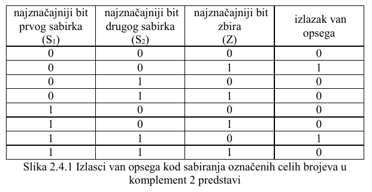
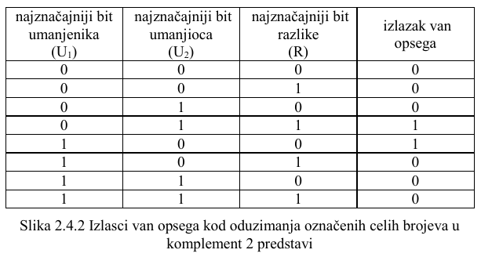
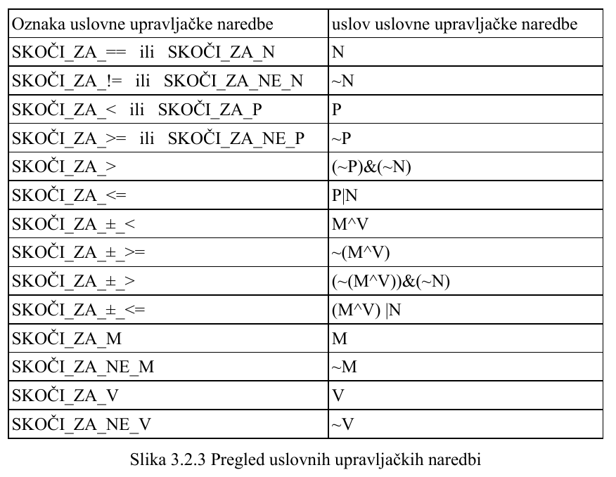
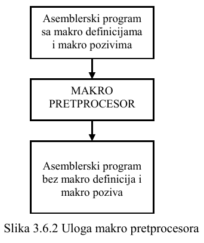
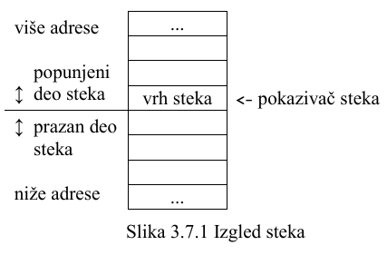
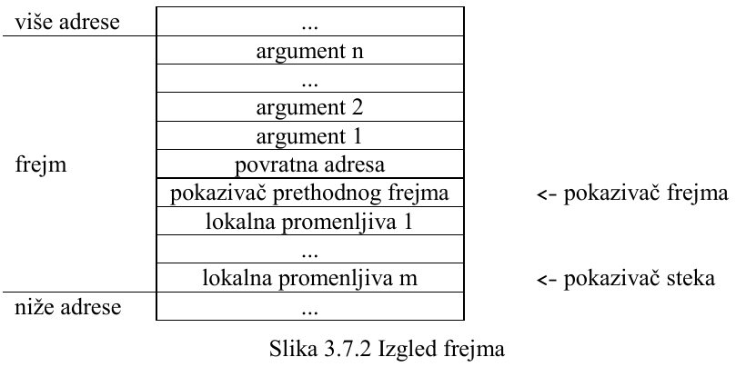

# Parcijalni 1
## 1. Uvod
### 1.1. Pojam arhitekture računara
- Arhitektura računara se bavi problemima upotrebe i pravljenja računara
- Način programiranja zavisi od osobina skupa naredbi računara
- Implementacija arhitekture naredbi obuhvata **organizaciju** i **izvedbu** računara
- Pojam arhitekture računara obuhvata arhitekturu naredbi i njenu implementaciju, jer su međusobno uslovljenje jedan drugom
### 1.2. Model računara
 - Celi, realni, znakovni i logički skup podataka nazivaju se i **prosti tipovi**
> Napomena: zapravo, *u svetu računarstva*, ne postoji nijedan drugi skup podataka sem logičkih, tj. 0 i 1 kao vrednosti binarnog sistema. Svakom celom broji u nekakvoj predstavi postoji ekvivalent u binarnom cifarnom sistemu. Znakovi su zapravo kodirani celi brojevi koji ih po dogovoru jednoznačno predstavljaju. Realni brojevi su samo celi brojevi odvojeni tačkom od svoje frakcije. Svet je jedno okrutno mesto puno prevaranata :(
- Od prostih, tj. osnovnih tipova grade se svi ostali
- Opštost ili okvire daju promenljive, sa svojim tipovima i vrednostima, kao i upravljačke operacije koje se izvršavaju nad njima
- Osnovne elemente procedurnih programskih jezika predstavljaju promenljive, vrednosti prostih tipova i operacije
#### Memorija
- Memorija je sastavljena od niza lokacija
- Svaka lokacija poseduje numeričku oznaku koja je jednoznačno određuje i njoj odgovara
- Pored numeričkih, postoje i simboličke, kao što su labele
- Preko labele pristupamo memoriju umesto preko adrese
- Ključna osobina lokacija jeste da mogu sadržati različite tipove podataka bez ikakvih problema
- Problem koji nastaje je raspoznavanje i tumačenje vrednosti u odnosu na upisanog podatka
- U lokaciji može biti upisana isti podatak i da pritom po odlučenom dogovoru bude dozvoljeno posmatrati na dva ili više različita načina
 > Npr. tumačenje označenih i neoznačenih celih brojeva
- Nekoj lokaciji se pristupa ukoliko je neophodno upisati ili pročitati podatak sa te lokacije
#### Procesor
- Procesor je sastavljen od sklopova i registara
- Sklopovi omogućavaju izvršavanje pojedinih operacija
- Registri su lokacije u memoriji procesora koje sadrže vrednosti tokom obrade podataka, tj. izvršavanja operacija
- Registri nemaju numeričku, već jedinstvenu simboličku oznaku preko koje im se pristupa
- Registri se nalaze u procesoru
- Pre izvršavanja operacije, procesor uzima **oznaku operacije** i **njene operande**
- Oznaka operacije i operandi obrazuju **naredbu**
#### Adresiranje
- Operandi se dele na **ulazne** i **izlazne**
- **VAŽNO:** ulazni operand svojim osobima (tip podatka i određeni opseg), jasno određuje kakve ulazne vrednosti su dozvoljene i iskoristljive
- **Pojašnjenje:** da bi dali odgovor na pitanje kakav je operand moramo da pogledamo koja ulazna vrednost je očekivana
> ukoliko traži konst. vredn. onda je neposredni, ukoliko traži da učita podatak iz registra onda je registarski itd.
- **VAŽNO:** Nije najjasnije razjašnjeno da **operacije** imaju izlaznu vrednost koja se razlikuje od izlaznog operanda **naredbe** . Izlazni operand predstavlja mesto gde treba upisati izlaznu vrednost operacije
##### Ulazni
- Neposredni - ulazna vredn. je neka konstanta npr. `72, 106, -301.41`
- Direktni - ulazna vredn. je memorijska lokacija sa koje treba pročitati podatak
- Registarski - ulazna vredn. je registar koji sadrži neophodan podatak
- Posredni - ulazna vredn. je registar koji sadrži mem. lokaciju sa koje treba pročitati podatak
-  Indeksni - ulazna vredn. je kombinacija indeksa i oznake registra; registar sadrži mem. lokaciju koja u sumi sa indeksom daje novu mem. lokaciju sa koje treba pročitati
##### Izlazni
- Direktni - operand sadrži memorijsku lokaciju na koju treba upisati podatak
- Registarski - operand je oznaka registra u koji treba upisati podatak
- Posredni - operand je oznaka registra, koji sadrži mem. lokaciju u koju treba upisati podatak
- Indeksni - operand je oznaka registra u komb. sa indeksom; registar sadrži mem. lokaciju koja sumirana sa indeksom daje novu mem. lokaciju u koju treba upisati podatak
##### Skup naredbi
- Skup naredbi procesora može se svesti na podskup aritmetičkih, kao i na relacione, logičke, upravljačke i naredbe prebacivanja
- Najvažnije aritmentičke naredbe jesu celobrojno sabiranje i oduzimanje; preko njih možemo izvesti sve ostale 
- Logičke naredne obuhvataju logičko *I, ILI i NE*
- Upravljačke obuhvataju bezuslovnu ili uslovnu izmenu redosleda (skok) izvršavanja naredbi programa 
##### Mašinske i asemblerske naredbe
- Lokacije mogu sadržati naredbe, ukoliko se oznake operacija naredbi kodiraju celim brojem
- Ovi brojevi predstavljaju kodove naredbi
-  Kod naredbe sa operandima obrazuje **mašinksu naredbu**
- **Mašinski format naredbe** jasno određuje kako se tumače cifre celog broja koji predstavlja mašinsku naredbu
- Simbolička predstava naredbe se naziva **asemblerska naredba**
- Prevođenje asemblerskog programa u mašinski program vrši program prevodilac **asembler**
- Prevođenje sa izvornog programa (procedurnog npr.) na asemblerski vrši **kompajler**
#### 1.3. Fizička osnova modela računara
- Razlozi za korišćenje samo `2` vrednosti za predstavljanje vrednosti u računaru su mnogobrojni, te ih stoga nećemo nabrajati; najvažnije je znati da zbog implementacije je najlakše koristiti `2` vrednosti, a to su `0` i `1`, koje se između ostalog poklapaju sa logičkim vrednostima netačno i tačno
- Upravo zbog poklapanja sa logičkim vrednostima moguće je opisati aritmetičke operacije za binarni brojevni sistem korišćenjem logičkih funkcija  
 
- Ukoliko posmatramo `a+b` kao logičku funkciju *I* (`a&b`), možemo predstaviti stanja korišćenjem nečega što će predstavljati našu funkciju
- Za potrebe ovakve implementacije koriste se električna kola *I, ILI, NE I...* 

- Važno je znati da pomoću log. funk. *NE I* možemo predstaviti sva ostala kola 
- *dopuniti tekst o prekidačima*
- Lokacije se prave kao nizovi ćelija, nazvanih **biti**
- Svakom bitu odgovara fizički uređaj (*flipflop*), sposoban za čuvanje **samo jedne log. vredn.**
- Sve lokacije sastoje se od istog i ograničenog broja bita, uređenih u **bajte** i **reči** 
- Lokacija se prave pomoću **sekvencijalnih kola** koja omogućavaju pamćenje logičkih vrednosti
- Sklopovi procesora se prave pomoću **kombinacionih kola**
#### 1.4. Pitanja
1. Šta obuhvata pojam arhitekture računara?
> Obuhvata arhitekturu naredbi i njenu implementaciju
2. Koji prosti (osnovni) tipovi postoje?
> Celibrojni, realni, znakovni i logički 
3. Koji su osnovni elementi procedurnih programskih jezika?
> Promenljive, vrednosti prostih tipova podataka i operacije
4. Šta obuhvata model računara?
> Memoriju, procesor, skup naredbi, adresiranje
5. Šta karakteriše memoriju?
> Lokacije, numerička ili simbolička oznaka, biti i stanje bita, tj. vrednost
6. Kako se može interpretirati sadržaj lokacije memorije?
> Kao bilo koji skup podataka, kao celi broj, kao znakovni podatak...
7. Šta karakteriše procesor?
> Sklopovi i registri
8. Koja adresiranja postoje?
> Neposredna, direktna, indirektna, registarska i indeksna
9. Šta ulazi u sastav mašinske naredbe?
> Kod naredbe, ulazni i izlazni operandi
10. Šta ulazi u sastav asemblerske naredbe?
> Simboličke oznake za operande, tj. labele kao i simboličke oznake za operacije
11. Kakav zadatak ima asembler?
> Asembler prevodi asemblerski kod u mašinski kod, tj. asemblerske naredbe u mašinske naredbe
12. Kakav zadatak ima kompajler?
> Kompajler prevodi izvorni program, pisan u procedurnom jeziku, u asemblerski program
13. Šta omogućuje podudarnost cifara binarnog brojnog sistema i logičkih
vrednosti?
> Fizička implementacija vrednosti korišćenjem 2 nivoa signala za predstavu tipova podataka, tj. `0` i `1`  
14. Koja logička funkcija opisuje zbir dve binarne cifre?
> Logička funckija *I* 
15. Šta određuje vrednost prekidačke funkcije?
> ???
16. Na šta utiče vrednost prekidačkog argumenta?
> ???
17. Šta omogućuju sekvencijalna kola?
> Pravljenje memorijskih lokacija koje čuvaju vrednost
18. Šta omogućuju kombinaciona kola?
> Ostvarivanje i sprovođenje pojedinih logičkih funckija, tj. pravljenje sklopova procesora

### 2. Brojni sistemi i predstave brojeva
> Dobronamerno je dat savet da se komplement desetke zanemari, zbog vrlo lošeg obrazloženja principa rada u komplementu desetke, te da se radije pogleda komplement dvojke. Uprkos ovom savetu, ukoliko nastavite sa čitanjem biće dodatnih pojašnjenja u vidu komentara, odnosno u nastavku beleški
#### 2.1. Aritmetika ograničenog broja cifara
- Celi brojevi (u ovom slučaju, iako postoji drugih), čuvaju se u mem. lokacijama u **pozicionoj predstavi**
- Poziciona predstava sprovedena je u delo tako što najmanje značajna cifra je skroz desno, dok je ona značajnija uvek levo od manje značajne
> Napomena: gore napisana rečenica je tačna za dati primer u knjizi, mogući su i drugi zapisi koji bi cifre u mem. lokaciju upisivali obrnutim redosledom, te uporedo postoji i problem prikazivanja tih upisa, zbog slobode izbora da se upis prikaže kako ide u suprotnom smeru... 
- Ovim zapisom možemo redosledno primenjivati tablicu sabiranja na odgovarajuće cifre, poput sabiranja koje koristimo u pravom životu
##### Komplement 10 predstava označenih celih brojeva
- Prvobitan problem sa kojim se srećemo je ponašanje prema predznaku sabiraka
- Da bi odredili predznak izlazne vrednosti upoređujemo apsolutne vrednosti sabiraka
- Potom se manja apsolutna vrednost oduzima od veće i predznak upisuje na kraju operacije
- Radićemo sledeće primere sa trocifrenim predstavom komplement `10` brojeva
- Na sledećoj slici je data tablica cifara i njihovih komplemenata

> Ljudima je veoma lako da razaznaju simbole od brojeva i uoče njhova značenja, međutim kompjuteri nisu ljudi, oni su fino uređeni algoritmi koji rade u okviru fizičkih i softverskih granica implementacije. Kada bi koristili `-` ili `+` za predstavljanje predznaka morali bi da kodiramo u implementaciju tako da mašina razume da neki podatak označava predznak. To je veoma skupo i teško za implementaciju, zbog toga koristimo već postojeće tipove podataka i po dogovoru propisno uređujemo da ukoliko je treća i najznačajnija cifra `9`, onda je predznak `-`, odnosno ukoliko je `0` onda je `+`
- Formiranje komplement 10 predstave negativnog celog broja zasniva se na tome da se negativni broj npr. `-57` prvo zapiše kao apsolutna vrednost, tj. `57`.  Potom se doda onoliko nula da ima `n` cifara, tj. u našem slučaju da ima 3 cifre. Sada broj `057` komplementiramo tako da umesto cifre npr. `7` piše cifra koja u zbiru sa njome daje cifru `9`. Sada smo dobili broj `942`, što je zapravo komplement `9`, te moramo dodati `+1` razultatu, za konačnih `943` 
> Poenta samog komplementiranja svodi se u lakšem oduzimanju brojeva. Računar ne razume oduzimanje, za čoveka je vrlo lako pojmiti da ukoliko se dve jabuke maknu sa stola, oduzeli smo dve jabuke, međutim računar nije čovek. Računar oduzimanje vrši preko sabiranja, štaviše računar uopste ne sabira, on primenjuje logična kola. Tužna sudbina, zaista.
- Ukoliko negativnu predstavu broja u kompl. 10 komplementiramo ponovo dobićemo apsolutnu vrednost negativnog broja.
> mene bi kompletiralo jedno 1000 evra.
- **VAŽNO:** Ukoliko se radi o *neoznačenim* brojevima, najznačajnija cifra se umesto za određivanje znaka koristi za čuvanje, tj. prikaz vrednosti.
> Napomena: Računar je malo piglu, on ne razume da li je broj označen ili ne, neko mu mora napomenuti, tj. mi moramo napisati naredbu da se prema podacima ponaša kao prema označenim ili neoznačenim. Poslu nikad kraja...
##### Izlazak van opsega
> nisam iz kuće izašao zbog ove knjige
- Problem kod implementacija jeste ograničeni broj cifara koje možemo čuvati i predstaviti
- Ukoliko dođe do potrebe da tokom operacija se zapiše nova značajnija cifra, te pritom implementacija ne podržava više od `n` cifara, mi ne možemo predstaviti taj broj
- Ovakav problem naziva se **izlazak van opsega**
> Iako se ovaj problem jeste zaista izlazak van opsega, kao što će biti reči u kasnijem delu, posmatramo dva posebna slučajeva, koja zavise od toga da li je broj označen ili neoznačen, i to su *pojavljivanje prenosa* i *neprirodna promena vrednosti najznačajnijeg bita*.
- **Neophodno** je uočiti da opseg i izlazak zavise od načina na koji posmatramo podatke
> Ukoliko tokom izvršavanja operacije se promeni vrednost najznačajnije cifre, došlo je do izlaska van opsega **ukoliko su brojevi smatrani označenim**, u suprotnom nije došlo do problema
##### Poređenje celih brojeva
- Kod određivanja relacija, izlazak van opsega pri *celobrojnom oduzimanju* (tj. sabiranju) zapravo nam pomaže da izvedemo ispravan zaključak
- U knjizi je opisana kompl. `10` te je najbolje pogledati tekst na `12.` strani 
> za više informacija pogledati kako radi oduzimanje u kompl. `2` predstavi; ukratko, oduzimanje dva označena broja svodi se na sabiranje; ukoliko je poz. po apsolutnoj vrednosti veći pri sabiranju sa negativnim desiće se da najznačajniji bit rezultata, koji označava predznak, bude `0` i imaćemo u prenosu `1`. Pogledati [vežbe V2](./Beleške.md#:~:text=sabiranje%20negativnog%20i%20pozitivnog%20dela%20svodi%20se%20na%20to%20da%20je%20za%20pozitivni%20broj%20bit%20najve%C4%87e%20vrednosti%20uvek%200%2C%20a%20ostali%20koji%20su%201%20dodaju%20vrednost%20onom%20pozitivnom%20delu)
##### Višestruka preciznost
- U zavisnosti na implementaciju, postoji ograničenje broja cifara sa kojim možemo raditi
- Da bi premostili ovaj problem koristimo višestruku preciznost
- Višestruka preciznost predstavlja korišćenje više nesekvencijalnih mem. lokacija za skladištenje podataka
- U radu sa višestrukom preciznošću mora se obrati pažnja na redosled obrađivanja podataka, te prvobitno radimo sa najmanje značajnim delovima vrednosti, a potom značajnijim
##### Zakoni aritmetike
- Za aritmetiku ograničenog broja cifara ne važe zakoni aritmetike
- Ukoliko u bilo kom trenutku dođe do izlaska van opsega mi ne možemo predstaviti tu vrednost, te se cifra odbacuje
- Zbog ovoga je izuzetno važno paziti na redosled operacija
#### 2.2. Predstavljanje realnih brojeva
- Poziciona predstava koju smo koristili u kompl. 10 nije efikasna zbog ogromnog broja cifara koje zahteva
> Računar za svoje potrebe zauzima određeni prostor, te tom prostoru se ne može olako pristupati jer možemo promeniti bitne podatke. Iz tog razloga kada se odvaja prostor za neki podatak odvaja se uvek fiksni deo memorije, međutim taj prostor nije uvek dobro iskorišćen. Više reči u sledećem primeru
- Realni broj 0.000000127 zauzima više cifara od dosada korišćenjih, te ga ne možemo predstaviti
- Najveći problem su mnogobrojne nule kojih se možemo rešiti u **normalizovanoj formi** 1.27 * 10^-7
- Najmanje prostora zauzima **mašinska normalizovana forma**, koja čitajući sa leva u desno ima sledeći raspored
- Najznačajnija cifra je predznak (`0` je `+`, `1` je `-`)
- Naredne dve cifre predstavljaju podešeni eksponent
> U našem slučaju, stepen je `-7` dok je konstanta podešavanja `10`
- Da ne bismo morali da brinemo o predznaku eksponenta od podešenog eksponenta oduzimamo konstantu podešavanja
- Preostalih sedam cifara sadrži frakciju, te dobijamo `0031270000`
> Dati primer MNF je za u kompl. `10` i uzet je iz knjige
- Ogromni problem sa kojim se susrećemo jeste preciznost predstavljanja realnih brojeva, ponajviše kod sabiranja dva broja čiji se eksponenti mnogo razlikuju
##### Aritkemika mašinske normalizovane forme
- **Predznak, podešeni eksponent i frakcije posmatraju se odvojeno**
- Prvo se određuje predznak rezultata
- Pre *sabiranja* i *oduzimanja* neophodno je izjednačiti eksponente
- Uvek se manji eksponent izjednačava sa većim, gde se pritom cifre frakcije pomeraju za jedno mesto udesno, gde je **moguće odbacivanje cifri**
- Nakon izjednačavanja eksponenata sledi sabiranje frakcija
- Kod *množenja*, eksponenti se sabiraju uz umanjivanje njihogov zbira za konst. podešavanja, a frakcije množe
- Kod *deljenja*, eksponenti se oduzimaju uz uvećavanje njihove razlike za konst. podešavanja, a frakcije dele
- Zbog odbacivanja suvišnih cifara frakcije, izlazak van opsega pojavljuje se samo kod eksponenata
#### 2.3. Binarni brojni sistem
> konačno smo pobegli od kompl. `10`
- U binarnom brojevnom sistemu koriste se samo cifre `0` i `1` , baza ovog sistema je dekadna dvojka
- Pre prelaska iz decimalnog (ili bilo kog drugog) u binarni brojevni sistem neophodno je izvršiti **konverziju**
- Postupak konverzije različit je za celi deo i razlomljeni deo broja
> Preporučeno je da se pronađe video na temu konverzija radije nego čitati iz knjige, međutim biće objašnjeno i ovde
##### Iz decimalnog u binarni
- Konvertovanje celog broja svodi se na deljenje broja sa bazom `2` (dekadna dvojka) i zapisivanja ostatka pri deljenju, dok količnik ponovo delimo; Zapis ostatka vrši se sa desna na levo; Postupak se ponavlja dok količnik ne bude jednak `0`
> $9 : 2 = 4$, `R(1) ->` $4 : 2 = 2$, `R(0) ->` $2 : 2 = 1$, `R(0) ->` $1 : 2 = 0$, `R(1)`
 `krajnji broj je 1001`
- **Pogledati** ovaj video https://youtu.be/lUdRbZDBgEE
- **Pogledati** ovaj video radi razumevanja MNF https://youtu.be/bbkcEiUjehk
- Konverzija razlomljenog dela svodi se na množenje dekadnom dvojkom, gde posle svakog množenja uzimamo celi deo proizvoda i zapisujemo sa strane; Kraj ovog postupka je kada frakcija postane `0`; Krajni zapis sa desna ulevo tako što pišemo prvu uzetu cifru celog dela broja    
> $0.375 * 2 = 0.75$ `pišemo 0 ->` $0.75*2 = 1.5$, `pišemo 1 nastavljamo sa 0.5 ->` $0.5 * 2 = 1.0$ `pišemo 1 i završavamo jer nam je ostala samo 0`
> konačan broj je 0.011 u binarnom brojevnom sistemu
- Ukoliko se konvertuje realni broj poput `23.75` ceo broj se posmatra odvojeno od razlomljenog, a potom se zapisuju zajedno kao `10111.11`
> Tehnički govoreno, ispravni zapis bi bio `0100110111110000` za 16 bitova, pošto se pozicija tačke izračunava preko eksponenta
###### Iz binarnog u decimalni 
- Konverzija iz binarnog u decimalni celi broj zasniva se čitanjem jedne po jedne cifre sa desna ulevo, množenjem te cifre sa stepenom dvojke, gde je prvi stepen `0`, i sabiranjem dobijenih rezultata
> `1001101` je zapravo $1*2^7 + 0  * 2^6 +$ ... $+0*2^1 + 1*2^0$
- Konverzija razlomljenog dela u decimalni brojevni sistem svodi se na uzimanju pojedinačne cifre sa leva udesno i množenja sa 2 na neki celobrojni stepen, počevši od -1, te tako sabiranjem svakog proizvod sa sledećim
> `0.0011` je zapravo $0*2^-1+0*2^-2+1*2^-3+1*2^-4 = 0.1875$ 
- Iz primera u knjizi videli smo da `0.2` konvertovano u binarni zapis je `0.0011`, međutim kada konvertujemo `0.0011` u decimalni dobijamo `0.1875`. Izgubili smo preciznost za `0.125`
###### Heksadecimalni
- Za skraćeno predstavljanje brojeva iz binarnog sistema koristi se heksadecimalni brojevni sistem
- Jedna heksadecimalna cifra odgovara tačno četiri binarne 
- Heksadecimalne cifre su od `0` do `9` dok su ono što bi decimalno bili brojevi `10, 11 , 12, 13, 14 , 15` cifre `A, B, C, D, E, F`
- Konverzija iz heksadecimalni u binarni brojevni sistem svodi se na uzimanje pojedinačne cifre, uzimanje njene decimalne vrednosti i prebacivanje u binarni brojevni sistem
> `E` je zapravo decimalno 14, što je binarno `1110`
- Konverzija iz binarnog u heksadecimalni radi se obrnutim redosledom
#### 2.4. Aritmetika ograničenog broja cifara u binarnom sistemu
- Princip je vrlo sličan radu opisanom u poglavljima kompl. `10`
- Binarni brojevni sistem radi u okviru predstave kompl. `2`
- Kompl. 2 predstava pozitivni se svodi na dodavanje nula do popunjavanja prostora
> 011 -> 00000011
- Kompl. 2 predstava negativnih se svodi na pisanje apsolutne vrednosti, potom komplementiranje svake cifre i uvećavanja rezultata za jedinicu
> -2 -> apsolutna vrednost 2 -> 00000010 kompl. -> 11111101 uvećavanje za 1 -> 11111110
##### Izlazak van opsega
- Kod obrade podataka neophodno je voditi računa o najznačajnijem bitu i njegovom stanju
- Ukoliko su brojevi posmatrani kao *neoznačeni* dozvoljena je promena najznačajnijeg bita, te to **ne predstavlja** izlazak van opsega
- Ukoliko su brojevi posmatrani kao *označeni*, i prilikom izvršavanja naredbi dođe do promene koja *nije prirodna* (dva negativna sabrana daju pozitivni) znamo da je došlo do izlaska van opsega
- Sledeća tablica prikazuje moguće slučajeve o kojim treba promisliti

- U knjizi je data i sledeća tablica za oduzimanje 

- **Interpretacija rezultata aritmetičkih operacija zavisi od interpretacije brojeva**
##### Poređenje celih brojeva
- Poređenje se svodi na oduzimanje prvog operanda od drugog i tumačenje rezultata
- Za opisivanje karakteristika razlike (sabiranja) zgodno je uvesti posebne **logičke promenljive** 
- *N* (nula) će u sebi sadržati `1` ako je rezultat operacije bio **nula**. U supronom sadrži `0` 
- *M* (minus) će u sebi sadržati 1 ako je rezultat operacije **negativna**. Ova logička promenljiva **jednaka je najznačajnijem bitu razlike**
- P (prenos) će u sebi sadržati 1 ukoliko je došlo do prenosa na najznačajnijem bitu, kome je i jednaka.
- V (van opsega) će sadržati 1 ako pri oduzimanju označenih celih brojeva **razlika izađe van opsega**. Ova log. promenljiva jednaka je zadnjoj koloni na slici 2.4.2 iznad ovog teksta
- **VAŽNO:** Pri svakom oduzimanju uvek će se stanja ovih promenljivi menjati zbog višeznačnog shvatanja i posmatranja brojeva
##### Višestruka preciznost
- Problem nemanja dovoljno binarnih cifara za prikaz i čuvanje rezultata rešava se uvođenjem višestruke preciznosti
- Delovi vrednosti nalaze se na različitim mem. lokacijama
- Pri radu u višestrukoj preciznost važno je poštovati redosled značajnosti cifara
##### Zakoni aritmetike
- Zbog mogućeg izlaska van opsega zakoni aritmetike **ne vaze** 
- Obavezno obratiti pažnju na redosled izvršavanja operacija
#### 2.5. Predstavljanje vrednosti realnog tipa u binarnom brojevnom sistemu
- **Mašinska normalizovana forma** se koristi i u binarnom brojevnom sistemu za predstavljanje vrednosti realnog tipa
- Gledajući sa leva udesno raspored cifara je sledeći za MNF8 (osam cifara)
- Prva cifra sadrži predznak (`0` je `+`, `1` je `-`)
- Naredne `4` cifre sadrže **podešeni eksponent** (govori nam gde se nalazi tačka)
- Kao konstanta podešavanja koristi se **vrednost 8**
- Eksponent može biti od `-8` do `7` i sabira se sa konst. podešavanja
- Poslednje tri pozicije sadrže tri manje značajne cifre frakcije
- Preostala najznačajnija cifra frakcije je `1`, koja je kod norm. forme podrazumevana
- Opet pogledati ovaj video https://youtu.be/bbkcEiUjehk
- Ukratko: eksponent je stepen na koji stepenujemo bazu sistema; potom frakciju sa dodatom *podrazumevanom* jedinicom tako da imamo `1.010` množimo sa 2^n
- Nailazimo na iste probleme kao kod kompl. `10`, a to su preciznost i opseg brojeva mogućih za predstavljanje
- Sva navedena pravila aritmeke za kompl. 10 predstavu važe i za kompl. 2 predstavu brojeva, te samo kod eksponenta može doći do izlaska van opsega
- Iz binarne mašinski normalizovane forme u decimalni zapis dolazimo kroz par koraka
1. Odredimo znak na osnovu prvog bita
2. Sračunamo frakciju na osnovu već opisanog postupka
>`.0011000000...` je zapravo $0*2^-1+0*2^-2+1*2^-3+1*2^-4 = 0.1875$
3. Na sračunatu frakciju sa desne strane dodajemo `1` tako da dobijemo `1.1875`
4. Potom množimo sa bazom sistema, što je `2`, na stepen koji daje konvertovani eksponent u decimalni broj
- U KNJIZI NIJE OBJAŠNJENO KAKO SE IZ REALNOG DOLAZI DO BINARNOG
##### Višeznačna interpretacija celih brojeva
- Već je bilo reči o višeznačnoj interpretaciji brojeva gde isti sled cifara može predstavljati dva dijematralno različita podatka
- Zbog ovoga, neophodna je konverzija, ukoliko se vrednost jednog tipa dodeljuje promenljivoj drugog tipa
> Pogledati primer u knjizi na strani `25.`
- **VAŽNO:** Konverzije nisu uvek moguće, jer MNF pokriva veći opseg vrednosti od celog tipa
#### 2.6. Pitanja
1. Šta omogućuje komplement predstava označenih brojeva?
> ???
2. Kako komplement predstava pojednostavljuje procesor?
> Sve aritmetičke operacije moguće je predstaviti preko sabiranja i komplementiranja
3. Kada se (ne) zanemaruje prenos sa najznačajnije pozicije prilikom
aritmetike celih brojeva?
> Ukoliko su brojevi neoznačeni
4. Šta ukazuje na izlazak van opsega?
> Kod označenih brojeva pojava neodgovarajuće cifre najznačajnijeg bita
5. Koje delove sadrži mašinska normalizovana forma?
> Predznak, podešeni eksponent i frakciju
6. Zašto je uvedena konstanta podešavanja (kako se ona koristi)?
> ???
7. Kako se obavlja aritmetika brojeva predstavljenih mašinskom
normalizovanom formom?
> Svaki deo se posmatra zasebno, predznaci se upoređuju, nad podešenim eksponentima se vrše posebne operacije, što važi i za frakciju
8. Gde dolazi do izlaska van opsega u aritmetici mašinske normalizovane
forme (u eksponentu ili frakciji)?
> Dolazi jedino u eksponentu
9. Gde se odbacuju prekobrojne cifre u aritmetici mašinske normalizovane
forme (u eksponentu ili frakciji)?
> Prekomerne cifre se izbacuju iz frakcije
10. Kako se obavljaju konverzije brojeva iz decimalnog u binarni brojni
sistem (i obrnuto)?
> Deljenjem sa bazom binarnog sistema i zapisivanjem ostatka `0` ili `1` u redosledu sa leva udesno
11. Koji binarni broj se dobije nakon konverzije decimalnog broja 4.25?
> ??? Nije naglašeno da li se znak beleži, koja je konst. podešavanja
12. Koji decimalni broj se dobije nakon konverzije binarnog broja 100.01?
> ??? Nije naglašeno da li se znak beleži, koja je konst. podešavanja
13. Koji heksadecimalni broj se dobije nakon konverzije binarnog broja
11010?
> 1 A
14. Koji binarni broj se dobije nakon konverzije heksadecimalnog broja 1A?
> 11010
15. Koja je komplement 2 predstava binarnog broja -100?
> `-100 -> -4 -> 4 -> 00000100 -> 11111011 -> 11111100`
16. Da li se prilikom sabiranja binarnih brojeva 01000100 i 01110000 javlja
izlazak van opsega (za obe interpretacije ovih brojeva)?
>  Označeni: DA Neoznačeni: NE
17. Na osnovu čega se određuje važenje relacija između (ne)označenih
brojeva?
> ???
18. Koja je mašinska normalizovana forma (MNF8) binarnog broja -101?
> `-101 -> -5 -> 5 -> 00000101 -> 11111010 -> 11111011`
19. Koji binarni broj odgovara mašinskoj normalizovanoj formi
11010010MNF8?
> 
### 3. Asemblersko programiranje
#### 3.1. Nivoi programiranja
- Kada se dva nivoa programiranja upoređuju, kažemo da je onaj koji sadrži **apstrakciju** (zanemarivanje) viši nivo
- Apstrakcija je vid zanemarivanja formata naredbi ili čitave arhitekture, koje su zamenjene nekim uopštenijim 
- Asemblerski i mašinski jezici svrstavaju se u grupu **programskih jezika niskog nivoa**đ
- Procedurni jezici se usled svoje prirode apstrakcija svrstavaju u **programske jezike visokog nivoa**
- Prednost programiranja na niskom nivou jeste potpuno iskorišćavanje mogućnosti računara, međutim mana je prekopotrebno razmišljanje o arhitekturi naredbi
#### 3.2. Arhitektura naredbi procesora *KONCEPT*
- Memorija procesora *KONCEPT* sastoji se od lokacija veličine **`16` bita**
- Krajnje desni bit je najmanje značajna cifra, odnosno krajnje levi bit je najznačajnija cifra
- Indeksi cifara su od `0` do `15`
- **Pristupanje memorijskoj lokaciji podrazumeva pristupanje svim njenim bitima**
- Adresni prostor procesora *KONCEPT* obuhvata 2^16 različitih adresa i njima pripadnih lokacija
- Procesor *KONCEPT* ima ukupno `16` **registara opšte namene**
- Registri su označeni kao komb. indeksa od `0` do `15` i znaka `%`, tj. `%0, %1, ... %14, 15`
- Svaki od registara opšte namene uređen je kao mem. lokacija
- Procesor *KONCEPT* poseduje i **status registar**, koji je takođe uređen kao mem. lokacija
- Najmanje značajni bit sadrži vrednost log. promenljive *N*, sledeći bit *M*, sledeći bit *P*, i četvrti bit (indeksno 3) *V*
- Procesor *KONCEPT* podržava neposredno, direktno, registarsko, posredno i indeksno adresiranje
##### Naredbe za celobrojnu aritmetiku
- *SABERI* sabira vrednost *PO* sa vrednošću *DO* (prvog i drugog operanda) i rezultat odlaže u drugom
- *SABERI_P* isto kao i *SABERI*, međutim dodaje vrednost promenljive *P* krajnjem rezultatu
- *DODAJ_1* uvećava vrednost ulaznog operanda za `1`
- *ODUZMI* oduzima vredn. *PO* od vredn. *DO* i odlaže rezultat u drugom
- *ODUZMI_P*  od krajnjeg rezultata oduzimanja oduzme i vredn. log. promenljive *P*
- *ODBIJ_1* umanjuje vrednost ulaznog operanda za `1`
- *UPOREDI* radi isto što i *ODUZMI*, međutim ne čuva rezultat. Postavlja vredn. log. promenljivih *N, M, P i  V* u skladu sa razlikom
##### Naredbe za rukovanje bitima
- Procesor *KONCEPT* podržava logičke naredbe: *I ILI i NE*; primena log. funk. se radi za svaki par bitova iz *PO* i *DO*  
- Pristupanje pojedinim bitima omogućavaju i naredbe *LEVO* i *DESNO*
- *LEVO* pomeranje svih bita binarne vrednosti *PO* za jedno mesto ulevo, što je isto množenju sa brojem `2`
- *DESNO* predstavlja obrnutu naredbu od *LEVO*; predstavlja i deljenje sa `2`
- Problem nastaje ukoliko je deljenik negativan, gde je neophodno voditi računa o znaku novodobijenog rezultata
##### Naredbe prebacivanja
- *PREBACI* prebacuje vrednost određenu *PO* u lokaciju određenu *DO*
- Izvršavanje ove naredbe **ne menja** vrednosti *N, M, P i V*
##### Upravljačke naredbe
-  Mašinski oblici prethodnih naredbi se smeštaju, u redosledu izvršavanja, u memorijske lokacije sa uzastopnim rastućim adresama
- Ovakav raspored je koristan zbog direktno ukazivanja koja naredba se izvršava posle koje
- Problem ovakvog rasporeda je rad sa vrednostima koje **zavise od obrađivanih podataka** 
- Kao rešenje uvode se **uslovne i bezuslovne upravljačke naredbe**
- Jedini operand ovih naredbi predstavlja mem. lokaciju na kojoj se nalazi naredba koja, ukoliko je uslov ispunjen, se treba izvršiti sledeća

- Zbog slove uloge, log. promenljive *N, M, P i V* se ujedno nazivaju i **uslovni biti**
- Procesor *KONCEPT* podržava bezuslove upravljačke naredbe: **SKOČI, POZIVI i NATRAG**
- *SKOČI* ima jedan operand koji određuje adresu naredbe koja će se izvršiti nakon izvršavanja  naredbe *SKOČI*
- *POZOVI* ima jedan operand koji određuje adresu naredbe, i pritom menja vrednost registra `%15` u adresu **sledeće naredbe posle *SKOČI**
- Adresa smeštena u registar `%15` naziva se  **povratna adresa**
- *NATRAG* nema operanada; Pozivanjem ove naredbe redosled izvršavanja se vraća na naredbu čiju adresu sadrži registar`%15`; **Podrazumeva se** da registar `%15` sadrži povratnu adresu, koju je prethodno upisala naredba *POZOVI*
#### 3.3. Asemblerski jezik *KONCEPT*
- Opis asemblerskog jezika propisuje **sintaksu** (način sastavljanja) naredbi i određuje  **semantiku** (značenje) asemblerskih naredbi
- Sintaksa je zadata nedvosmisleno i precizno u obliku pravila izraženih putem **EBNF** notacije
- Ime pravile je sa leve strane strelice `->`  dok sa desne se navodi odgovarajući oblik korišćenjem već opisanih pravila
- Razmak `" "` za odvajanje pravila; `|` za predstavljanje alternativnih delova pravila; `( )` za grupisanje delova pravila; `[ ]` za delove koji se mogu pojaviti jednom ili nijednom; `{}` za delove koji se mogu pojaviti `0, 1, n` puta
- **Za bolje razumevanje obavezno pogledati date definicije u knjizi od strane `36.`**
> U ovom tekstu nisu date definicije pravila  procesora *KONCEPT* zbog već opisanih u knjizi
- Neke bitnije osobine biće ispisane ovde
- Decimalni broj sadrži **najviše `4`** cifre
- Heksadecimalni broj **uvek započinje** znakovima `0x`
- Heksadecimalni broj sadrži **najviše `6` znakova** 
- Labela sme da sadrži **najviše 30 znakova**
- Postoje dve **asemblerske direktive** procesora *KONCEPT*, a to su **ZAUZMI** i **NAPUNi**
- Asemblerske direktive **nisu izvršne** prirode; One za razliku od naredbi koje su upućene direktno procesoru,  direktive tokom prevošenja izazivaju zauzimanje mem. lokacija za rad
- *ZAUZMI* zauzima broj mem. lokacija jednak vredn. njenog operanda
- *NAPUNI* zauzima **samo `1`** mem. lokaciju i u nju upisuje vredn. koju sadrži operand
- Nakon reči **POČETAK** i razmaka navodi se **ulazna labela**
> POČETAK ulaz
- Ulazna labela prethodi **ulaznoj asemblerskoj naredbi**
> ulaz: PREBACI_NR $12, %13 (Mihajlo će razumeti)
- Izvršavanje asemblerskih naredni prati redosled u kom su one napisane, sa postojećim izmenama usled skokova, odnosno upravljačkih naredbi
#### 3.4. Primeri asemblerskih naredbi
- **Pregledati i razmisliti o primerima u knjizi, počevši od `39.` strane**
#####  Rukovanje mašinskom normalizovanom formom
- Radićemo sa `16` bita
- Prvi bit je bit predznaka
- Sledećih `8` bitova predstavlja podešeni eksponent čija je konst. podešavanja jednaka `128`
- Preostalih `7` bita sadrže `7` manje značajnih bita frakcije
- **Ne zaboraviti da je najznačajniji bit frakcije uvek 1 i da se ne prikazuje**
- Izmenjivanje pojedinačnih vrednosti bitova moguće je koriščenjem **maski** i odgovarajuće logičke funkcije
#### 3.5. Potprogram
- **Potgram** omogućuje opisivanje izračunavanje vrednosti, odnosno opisivanje rukovanja strukturama podataka, koje je odvojeno od glavnog programa
- Potprogram nije ništa drugo do skup naredbi koji je osmišljen da uzima vrednosti nekog drugog programa, da ih obradi i potom upiše, tj. vrati
- **Opis** potprograma prate njegovi **pozivi**
- Ovo je veoma korisno jer možemo pozivati potprogram samo na osnovu poznavanja neophodnih parametara, bez da znamo čitavu strukturu potprograma
- Upotreba **parametara** pomaže nam da potprogram se može izvršavati više puta, tokom kojih obrađuje različite podatke
- Svako izvršavanje potprograma odnosi se na određene vrednosti parametara, koji se nazivaju **argumenti**
- Izvršavanju potprograma prethodni njegov poziv i spremanje vredn. parametara
- U pozivu potprograma se određuje povratna adresa, sa koje se učitava sledeća naredba pri završetku rada potprograma
- U **ulaznoj tački** potprograma se zauzimaju lokacije za **lokalne promenljive**, dok se u **izlaznoj tački** ove lokacije oslobađaju
- Lokalne promeljive potprograma se nazivaju i **dinamičke**, iz razloga što postoje samo u toku izvršavanja potprograma, za razliku od **statičkih** i **globalnih**
- **Područje važenja** ili opseg promenljivih vezan je za deo u kom je pomenuta promenljiva opisana, ukoliko je to potprogram, ona će postojati od trenutka njihovog definisanja do kraja izvršavanja potprograma, ukoliko je to glavni program, postojaće od trenutka definisanja do kraja izvršavanja 
- Potprogrami se dele na **funkcije** i **procedure**
- *Funkcije* omogućuju opisivanje preuzimanja vrednosti promenljivih i potom izračunavanje; Funkcije imaju samo **jednu povratnu vrednost**; 
- *Procedure* omogućuju opisivanje preuzimanje vrednosti promenljivih i izmenu njihovih vrednosti; Mogu da imaju više **ulazno-izlaznih parametara**
##### Asemblerski oblik potprograma
- Programer se mora pobrinuti za: prenos argumenata, poziv potprograma i povratak iz potprograma nakon završetka izvršavanja
- Za pozivanje koristimo upravljačku naredbu *POZOVI* koja smešta povratnu adresu **u registar `%15`**, i pritom omogućuje izvršavanje potprograma
- Za povratak iz potprograma koristimo upravljačku naredu *NATRAG* 
- Registri procesora *KONCEPT* mogu biti iskorišćeni za prenos argumenata **osim rezirvisanog registra `%15` čija se adresa ne sme ručno menjati**
#### 3.6. Makro
- Korišćenje potprograma povećava broj naredbi zbog podešavanja parametara, kao i koriščenja upravljačkih naredbi *POZOVI* i  *NATRAG* 
- Međutim, ukoliko je neophodno izvršiti određeni sled operacija više puta, korišćenje potprograma može **znatno skratiti broj naredbi**
- **Makro potprogram** predstavlja posebnu labelu koja se, tokom prevođenja asemblerskih naredbi u mašinske naredbe, zamenjuje **naredbama tela makroa** 
- Da bi bilo moguće koristiti makroe, neophodno je da postoji **definicija makroa**, tj. opis potprograma, i sam **poziv makroa** koji označava mesto korišćenja makroa
- Ukoliko definicija makroa zahteva parametre, poziv mora sadržati odgovarajuće argumente
- Zamenu makro poziva obavlja poseban program koji se naziva **makro pretprocesor**
- Pre nego što asembler stigne da prevede tekst, makro pretprocesor obradi isti tako što umesto makroa upisuje naredbe iz njegovog tela  
  
- **VAŽNO:** Glavna razlika između potprograma i makroa jeste što telo potprograma **postoji samo jednom**, dok se telo makroa **zamenjuje sa svakim pojavljivanjem labele** koja taj makro označava
- Time rečeno, korišćenjem poziva potprograma, redosled izvršavanja bi se promenio i započelo bi izvršavanje potprograma, nakon kojeg bi se vratio u glavni
- Korišćenje makroa bi umetnulo linije naredbe **tokom prevođenja** u niz naredbi i one se ne bi izvršile dokle god ne dođe red na njih
- **VAŽNO:** Upotreba potprograma nam takođe omogućava da ga pozovemo i iz nekog drugog programa, bez da moramo opet pisati isto telo
##### Opis makro definicija i makro poziva
- **Pogledati definicije sintakse od `51.` strani**
- Makro ime sme **imati najviše `30` znakova**
- U makro pozivu se koristi ime prethodno definisanog makroa, gde zadati argumenti prate redosled definisanih parametara
##### Primeri  makro definicija i makro poziva
- Pogledati primer u knjizi na `52.` strani
- Višestruki pozivi makroa u jednom asemblerskom programu izazivaju višestruku pojavu istih labela
- Ovaj problem se javlja ili korišćenjem parametara na mestu spornih labela ili prepuštanje rešavanja problema pretprocesoru
> Verovatno se misli da korišćenje parametara znači korišćenje registara umesto labeli, mada knjiga ovo ne razjašnjava
##### Makro definicija sa makro definicijom
- Moguće je da telo makro def. sadrži telo druge makro def.
- Pri tome poziv unutrašnjeg makroa mora slediti odmah nakon poziva spolašnjeg makroa
- Pogledati primer na `53.` strani knjige
- Primer u knjizi prikazuje makro kom se prosleđuju određeni argumenti
- Prosleđeni argumenti se koriste za definiciju unutrašnjeg makroa
- Potom prvi prosleđeni argument, koji nam je takođe poziv makroa, se prosleđuje njegovom definicijom koju smo prethodno definisali
##### Uslovno asembliranje
- Za uslovno asembliranje potrebna je uslovna direktiva koja određuje pod kojim uslovom makro pretprocesor šalje sadržaj tela uslovne direktive na asembliranje
- Ukoliko uslov nije ispunjen, telo uslovne direktive se ne uključuje u asemblerski program
- **Pogledati pravila na strani `54.`**
- Uslovna direktiva je upućena makro pretprocesoru, što znači da nije izvršne prirode
#### 3.7. Stek
> nije 64
- Ukoliko se prisetimo, korišćenjem naredbe *POZOVI* u registar `%15` smešta se povratna adresa, i to je moguće čuvanje **samo jedne**
- Zbog prirode ove naredbe, nije moguće pozivanje iz potprograma u potprogram, jer bi došlo do **promene povratne adrese**
- Povratak iz potprograma vrši se u obrnutom redosledu od pozivanja, jer se vraćamo natrag iz najskorašnjeg poziva u onaj pre i tako do glavnog programa
> Ovo je moguće zamisliti kao oblačenje više jakni; Ukoliko ste obukli 5 jakni, i želite da direktno izvučete nešto iz džepa prve jakne, to jednostavno nije izvodljivo; Prvobitno biste morali da skinete petu, potom četvrtu, i tako sve jakne do prve. Ovo je princip rada stek.
- Problem sa kojim se susrećemo je čuvanje povratnih adresa, i to u tačnom redosledu kako ne bismo zalutali i poremetili rad programa
- Za naše potrebe uvodi se struktura pod imenom **stek**, te ćemo sada opisati šta je 
- Stek predstavlja niz memorijskih lokacija u koje se podaci upisuju u nedvosmisleno jednom smeru, dok se podaci čitaju u obrnutom
- Stek je osmišljen sa idejom da se podaci upisuju jedan za drugim i da se tako čitaju
>Sa steka bi trebalo čitati samo podatak koji je zadnji upisan, međutim kao što ćemo to videti, ovo pravilo se često krši radi olakšanog rada sa podacima
- Ukoliko se pomenute povratne adrese smeštaju u niz mem. lokacija u opisanom redosledu, tako da su one jedna do druge od prvobitno upisanje po poslednje, tada je jedino neophodno poznavati adresu lokacije do koje je niz popunjen
- Od ove lokacije se nastavlja punjenje niza, tj. našeg steka
- Za čuvanje adrese do koje je stek popunjen koristi se **pokazivač steka**, čiju ulogu ima određeni registar  
 
- Rukovanje stekom obuhvata: zauzimanje memorijskih lokacija za stek, pripremu steka za korišćenje (odnosno, inicijalizaciju pokazivača steka), smeštanje sadržaja u stek i preuzimanje sadržaja sa steka
##### Frejm ili okvir
- Stek se koristi za čuvanje povratne adrese, lokalnih promenljivih i prenos argumenata u potprogram
- Skup lokacija na steku koje sadrže povratnu adresu i argumente naziva se **frejm** 
- Frejm nastaje prilikom poziva potprograma, a nastaje po povratku iz potprograma
- Lokacijama na steku moguće je pristupati putem pokazivača steka, međutim postojanje više frejmova na steku stvara problem raznavanja gde počinje i gde se završava određeni frejm
- Za reševanje ovog problema uvodi se **pokazivač frejma** ili kako se stručno zove, bazni pokazivač
- Ulogu pokazivača frejma ima registar koji sadrži početnu adresu frejma, tj. baznu lokaciju
- Da bi se, za svaki postojeći frejm, mogao odrediti njegov par pokazivača zgodno uvezati frejmove u listu
> Knjiga ovde ne napominje šta misli pod uvezivanjem u listu
- Ovo se postiže tako što baza najmlađeg frejma sadrži vrednost stek pokazivača prethodnog frejma; Ta vrednost je. adresa mem. lokacije do koje je poslednji frejm napunjen
 **VAŽNO:** Trenutni *pokazivač steka* sadrži istu adresu mem. lokacije kao i *pokazivač frejma* najmlađeg frejma
- Frejm steka takođe sadrži i lokalne promenljive  
 
- Za pristup lokacijama frejma zgodno je koristiti indeksno adresiranje; Za početnu adresu ćemo koristiti vrednost pokazivača frejma, a za indeks relativnu udaljenost potrebne lokacije frejma od baze
- Rukovanje frejmom vezano je za poziv potprograma, sa kojim je taj frejm povezan
- **Pogledati primer u knjizi na strani `59.`**
- Korišćenje steka može da uzrokuje **dinamičke greške**, od kojih je jedna nemanje dovoljno mem. lokacija za potrebe rada programa
- **VAŽNO:** Procesor *KONCEPT* ne podržava opisani stek, zbog čega ne postoje posebne naredbe za rad sa stekom; Ukoliko bi te naredbe postojale bile bi ekvivalentne makroima *NA_STEK* i *SA_STEKA* iz knjige
#### 3.8. Pitanja
1. Koji programski jezici niskog i visokog nivoa postoje?
> Niskog: Mašinski i asemblerski       Visokog: Procedurni
2. U čemu se razlikuju asemblerski i mašinski jezici?
> U korišćenju različitih arhitektura naredbi, gde asemblerski jezici zanemaraju format mašinskih
3. Kada je opravdano korišćenje asemblerskog i mašinskog jezika?
> Mašinskog: Samo kada ne postoje prevodioci za asemblerske ili procedurne jezike
> Asemblerskog: U slučajevima koji zahtevaju da se mogućnosti računara iskoriste u potpunosti
4. Koliki adresni prostor omogućuju 2 bita?
> Omogućava četiri mem. lokacije
5. Koje naredbe omogućuju aritmetiku u višestrukoj preciznosti?
> *SABERI_P* i *ODUZMI_P*
6. Koje naredbe u toku svog izvršavanja ne menjaju uslovne bite?
> Uslovno upravljačke naredbe kao i **naredbe prebacivanja**
7. Koje aritmetičke naredbe postoje?
> *SABERI, SABERI_P, DODAJ_1, ODUZMI, ODUZMI_P, ODBIJ_1, UPOREDI*
8. Koje naredbe za rukovanje bitima postoje?
> *I, ILI, NE, LEVO, DESNO*
9. Koje upravljačke naredbe postoje?
> *SKOČI_ZA_==, SKOČI_ZA_!=, SKOČI_ZA>=, SKOČI_ZA<=,  SKOČI_ZA> , SKOČI_ZA<,  SKOČI_ZA_+-_<* i još mnoge
10. Koje kombinacije operanada koriste naredbe prebacivanja?
> Neposredne, direktne, registarske, posredne, indeksne
11. Koje naredbe omogućuju otkrivanje izlaska van opsega?
> Uslovno upravljačke naredbe 
12. Koje naredbe imaju dva operanda?
> Naredbe prebacivanja, sve naredbe aritmetike sem *ODBIJ_1* i *DODAJ_1*, naredbe za rad sa bitovima *I, ILI* i *NE*
13. Koje naredbe imaju jedan operand?
> Naredbe *ODBIJ_1, DODAJ_1, LEVO, DESNO, POZOVI*, upravljačke naredbe skokova
14. Koje naredbe su bez operanada?
> Naredba *NATRAG*
15. Koje asemblerske direktive postoje?
> *ZAUZMI, NAPUNI*, te bi se moglo reći i makroi i uslovne direktive
16. Šta karakteriše potprogram?
> Opis potprograma i njegovi pozivi, njegovi parametri i povratna vrednost obrade podataka
17. Šta karakteriše makro?
> Makro definicija i makro pozivi, kao i njegovi parametri
18. Šta karakteriše funkciju?
> Sve što karakteriše potprogram i činjenica da ima samo jednu povratnu vrednost
19. Šta karakteriše proceduru?
> Sve što karakteriše potprogram i činjenjica da može imati više ulazno-izlaznih parametara
20. Koje asemblerske naredbe su uvedne radi asemblerskih potprograma?
> *POZOVI, NATRAG*
21. Šta je vezano za poziv asemblerskog potprograma?
> Prenos argumenata, pozivanje potprograma i smeštanje povratne adrese u registar `%15`, ulazak u telo potprograma,  zauzimanje mem. lokacija za lokalne promenljive, na kraju potprograma izvršavanje naredbe *NATRAG*
22. Šta je vezano za makro poziv?
> Prenos argumenata i zamenu poziva sa naredbama iz njegovog tela, koju obavlja pretprocesor
23. Kako upotreba potprograma utiče na dužinu programa i vreme njegovog
izvršavanja?
> Korišćenje potprograma znatno utiče na dužinu programa gde je potrebno učitati manje naredbi u memoriju u poređenju sa korišćenjem makroa, međutim tokom izvršavanja programa, izvršiće se veći broj naredbi zbog dodatnih upravljačkih naredbi *POZOVI* i *NATRAG*
24. Kako upotreba makroa utiče na dužinu programa i vreme njegovog
izvršavanja?
> Umesto poziva makroa, umetnuće se naredbe iz tela makroa, zbog čega će se u memoriju učitati više naredbi i program će biti veći, međutim vreme izvršavanja će uobičajeno biti kraće, nego kod običnih potprograma, jer nema dodatnih upravljačkih naredbi *POZOVI* i NATRAG 
25. Ko obavlja zamenu makro poziva modifikovanim naredbama iz makro
definicija?
> Upravlja poseban program nazvan pretprocesor
26. Gde su definisane i kada postoje globalne promenljive?
> Važe od trenutka svog definisanja pa do kraja izvršavanja glavnog programa
27. Gde su definisane i kada postoje lokalne promenljive?
> Lokalne promenljive definisane su u okviru nekog potprograma i važe od trenutka definisanja do kraja izvršavanja potprograma 
28. Šta se smešta na stek?
> Na steku se smeštaju argumenti i povratne adrese
29. Kako se rukuje stekom?
> Podaci se upisuju u posebnom redosledu tako da su upisani u jednu za drugom mem. lokacijom i čitaju se u obrnutom redosledu
30. Šta sadrži frejm?
> Povratnu adresu, argumente, lokalne promenljive 
