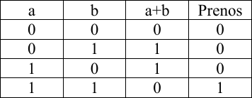
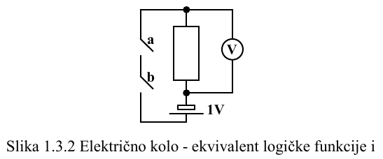

# Parcijalni 1
## 1. Uvod
### 1.1. Pojam arhitekture računara
- Arhitektura računara se bavi problemima upotrebe i pravljenja računara
- Način programiranja zavisi od osobina skupa naredbi računara
- Implementacija arhitekture naredbi obuhvata **organizaciju** i **izvedbu** računara
- Pojam arhitekture računara obuhvata arhitekturu naredbi i njenu implementaciju, jer su međusobno uslovljenje jedan drugom
### 1.2. Model računara
- Celi, realni, znakovni i logički skupovi podataka nazivaju se i **prosti tipovi**
- Od prostih, tj. osnovnih tipova grade se svi ostali
- Opštost ili okvire daju promenljive, sa svojim tipovima i vrednostima, kao i upravljačke operacije koje se izvršavaju nad njima
- Osnovne elemente procedurnih programskih jezika predstavljaju promenljive, vrednosti prostih tipova i operacije
#### Memorija
- Memorija je sastavljena od niza lokacija
- Svaka lokacija poseduje numeričku oznaku koja je jednoznačno određuje i njoj odgovara
- Pored numeričkih, postoje i simboličke, kao što su labele
- Preko labele pristupamo memoriju umesto preko adrese
- Ključna osobina lokacija jeste da mogu sadržati različite tipove podataka bez ikakvih problema
- Problem koji nastaje je raspoznavanje i tumačenje vrednosti u odnosu na upisanog podatka
- U lokaciji može biti upisana isti podatak i da pritom po odlučenom dogovoru bude dozvoljeno posmatrati na dva ili više različita načina
 > Npr. tumačenje označenih i neoznačenih celih brojeva
- Nekoj lokaciji se pristupa ukoliko je neophodno upisati ili pročitati podatak sa te lokacije
#### Procesor
- Procesor je sastavljen od sklopova i registara
- Sklopovi omogućavaju izvršavanje pojedinih operacija
- Registri su lokacije u memoriji procesora koje sadrže vrednosti tokom obrade podataka, tj. izvršavanja operacija
- Registri nemaju numeričku, već jedinstvenu simboličku oznaku preko koje im se pristupa
- Registri se nalaze u procesoru
- Pre izvršavanja operacije, procesor uzima **oznaku operacije** i **njene operande**
- Oznaka operacije i operandi obrazuju **naredbu**
#### Adresiranje
- Operandi se dele na **ulazne** i **izlazne**
- **VAŽNO** ulazni operand svojim osobima (tip podatka i određeni opseg), jasno određuje kakve ulazne vrednosti su dozvoljene i iskoristljive
- **Pojašnjenje:** da bi dali odgovor na pitanje kakav je operand moramo da pogledamo koja ulazna vrednost je očekivana
> ukoliko traži konst. vredn. onda je neposredni, ukoliko traži da učita podatak iz registra onda je registarski itd.
- **VAŽNO:** Nije najjasnije razjašnjeno da operacije imaju izlaznu vrednost koja se razlikuje od izlaznog operanda. Izlazni operand predstavlja mesto gde treba upisati izlaznu vrednost operacije
##### Ulazni
- Neposredni - ulazna vredn. je neka konstanta npr. `72, 106, -301.41`
- Direktni - ulazna vredn. je memorijska lokacija sa koje treba pročitati podatak
- Registarski - ulazna vredn. je registar koji sadrži neophodan podatak
- Posredni - ulazna vredn. je registar koji sadrži mem. lokaciju sa koje treba pročitati podatak
-  Indeksni - ulazna vredn. je kombinacija indeksa i oznake registra; registar sadrži mem. lokaciju koja u sumi sa indeksom daje novu mem. lokaciju sa koje treba pročitati
##### Izlazni
- Direktni - operand sadrži memorijsku lokaciju na koju treba upisati podatak
- Registarski - operand je oznaka registra u koji treba upisati podatak
- Posredni - operand je oznaka registra, koji sadrži mem. lokaciju u koju treba upisati podatak
- Indeksni - operand je oznaka registra u komb. sa indeksom; registar sadrži mem. lokaciju koja sumirana sa indeksom daje novu mem. lokaciju u koju treba upisati podatak
##### Skup naredbi
- Skup naredbi procesora može se svesti na podskup aritmetičkih, kao i na relacione, logičke, upravljačke i naredbe prebacivanja
- Najvažnije aritmentičke naredbe jesu celobrojno sabiranje i oduzimanje; preko njih možemo izvesti sve ostale 
- Logičke naredne obuhvataju logičko *I, ILI i NE*
- Upravljačke bezuslovnu ili uslovnu izmenu redosleda izvršavanja naredbi programa (skok)
##### Mašinske i asemblerske naredbe
- Lokacije mogu sadržati naredbe, ukoliko se oznake operacija naredbi kodiraju celim brojem
- Ovi brojevi predstavljaju kodove naredbi
-  Kod naredbe sa operandima obrazuje **mašinksu naredbu**
- **Mašinski format naredbe** jasno određuje kako se tumače cifre celog broja koji predstavlja mašinsku naredbu
- Simbolička predstava naredbe se naziva **asemblerska naredba**
- Prevođenje asemblerskog programa u mašinski program vrši program prevodilac **asembler**
- Prevođenje sa izvornog programa (procedurnog npr.) na asemblerski vrši kompajlier
#### 1.3. Fizička osnova modela računara
- Razlozi za korišćenje samo `2` vrednosti za predstavljanje vrednosti u računaru su mnogobrojni, te ih stoga nećemo nabrajati; najvažnije je znati da zbog implementacije je najlakše koristiti `2` vrednosti, a to su `0` i `1`, koje se između ostalog poklapaju sa logičkim vrednostima netačno i tačno
- Upravo zbog poklapanja sa logičkim vrednostima moguće je opisati aritmetičke operacije za binarni brojevni sistem korišćenjem logičkih funkcija

- Ukoliko posmatramo `a+b` kao logičku funkciju *I* (`a&b`), možemo predstaviti stanja korišćenjem nečega što će predstavljati našu funkciju
- Za potrebe ovakve implementacije koriste se električna kola *I, ILI, NE I...* 

- Važno je znati da pomoću log. funk. *NE I* možemo predstaviti sva ostala kola 
- *dopuniti tekst o prekidačima*
- Lokacije se prave kao nizovi ćelija, nazvanih **biti**
- Svakom bitu odgovara fizički uređaj (*flipflop*), sposoban za čuvanje **samo jedne log. vredn.**
- Sve lokacije sastoje se od istog i ograničenog broja bita, uređenih u **bajte** i **reči** 
- Lokacija se prave pomoću **sekvencijalnih kola** koja omogućavaju pamćenje logičkih vrednosti
- Sklopovi procesora se prave pomoću **kombinacionih kola**
