# V1
### Registri

- 32-bitni mikroprocesor ==LITTLE ENDIAN== 
	> prvo se upisuje bajt najniže vrednosti 
- Isti princip raspodele važi i za ebx, ecx, edx
- promena ax menja i eax, nije moguće koristiti oba istovremno   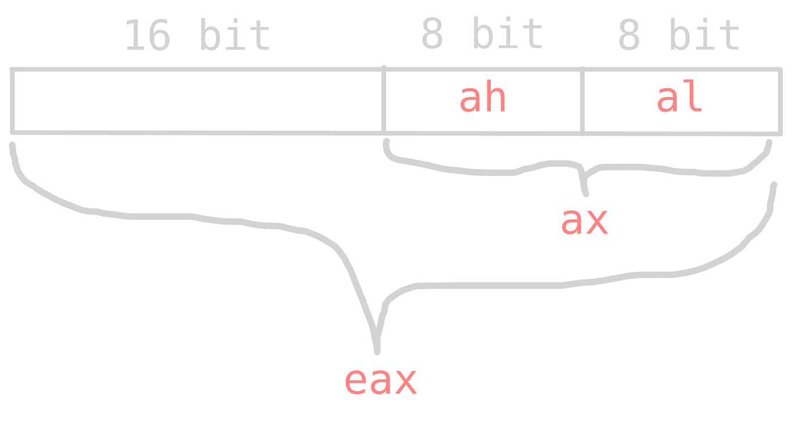  

### Zastavice

- ## ==🟡Procesor ne razlikuje označene i neoznačene brojeve==
> 11101001 može biti 213 ili -23 U ZAVISNOSTI KAKO MI GLEDAMO NA BROJEVE
- c (carry) - zastavica prekoračenja za unsigned brojeve
- o (overflow) -  zastavica za označene signed brojeve 
- z (zero) - da li je rezultat jednak nuli
- s (sign) - da li je najviši bit == 1
### AT&T sintaksa
- pristup registrima vrši se putem *%* prefiksa 
- neposredni operandi označeni su prefiksom *$*
- *b* - 8 bita
- *w*  - 16 bita
- *l* - 32 bita
- ## ==VREDNOST SE UVEK ČUVA U DESNOM OPERANDU==
-  gcc -m32 -g -o primer primer.c - komanda kompajliranje
### GDB: registri i zastavice
- layout reg 
- p $eax 
- p $eflags prikazuje zastavice
 > focus cmd / focus src prebacuje kontrolu sa koda na komandu liniju i obrnuto

# V2
#### Neoznačeni i označeni brojevi
- procesor jedino zaista poznaje cele brojeve
> da li je promenljiva označena ili neoznačena zavisi od programera
- CARRY - NEOZNAČENI
- OVERFLOW - OZNAČENI
- najviše jedan operand može biti pristupanje memoriji
> drugi može biti registar ili konstanta tipa $0x5

#### Definisanje numeričkih podataka
- primer: .word 0x153
> ime_labele: .veličina 0xvrednost
- .byte .word. .long .quad
- movl $primer, %eax bi prebacio adresu na koju pokazuje primer tipa 0x100
- movl primer, %eax bi prebacio vrednost "kutijice" tipa 0x5
#### Definisanje i upotreba konstanti
- const1 = 0x5 ili nesto = 0x20
- PAZI SAD OVO, vrednosti konstante mora da se pristupi sa $, dok je bez nje samo adresa
>  movl $const1+const2, %eax

#### Inicijalna vrednost promenljive
- neinicijalizovana promenljiva pokazuje na istu adresu kao naredna promenljiva  
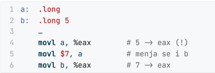  

#### Prikaz u GDB-u
- *p/x* heksadecimalno
- *p/u* unsigned
- *p/d* signed
- *display* ispisuje nakon svakog koraka
- komanda tipa x/3xb $promenljiva prikazaće 3 bajta od promenljive u heksadecimalnom obliku
> 3 za koliko puta, x za heksadec, b za bajt 

#### Višestruka preciznost
- kada broj se ne može smestitit u 32-bitni registar, možemo ga smestiti putem korišćenja više njih, te tako što ćemo deo vrednosti smestiti u prvi registar, dok ćemo drugi u viši
- najčešće se koriste samo dvostruke preciznosti
#### Sabiranje u dvostrukoj preciznosti
- sabiraju se niži, te potom viši delovi 
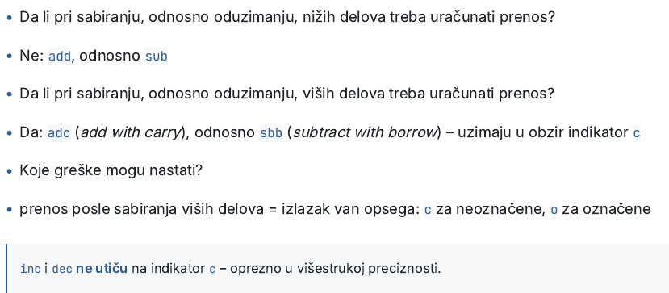 
- addl dodaje bez da uračunava vrednost carry zastavice
- adcl doda vrednosti i doda jos carry zastavicu
- kompelement dvojke ukoliko je prvi bit 1 racuna kao negativan broj

- sabiranje negativnog i pozitivnog dela svodi se na to da je za pozitivni broj bit najveće vrednosti uvek 0, a ostali koji su 1 dodaju vrednost onom **pozitivnom delu**
- kada se pozitivni deo potom sabere i doda negativnom npr -128 to se negativni deo umanjuje
- KOMPJUTER NE RAZUME ODUZIMANJE  
 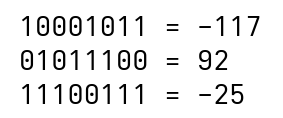  
# V3
#### Načini adresiranja
 
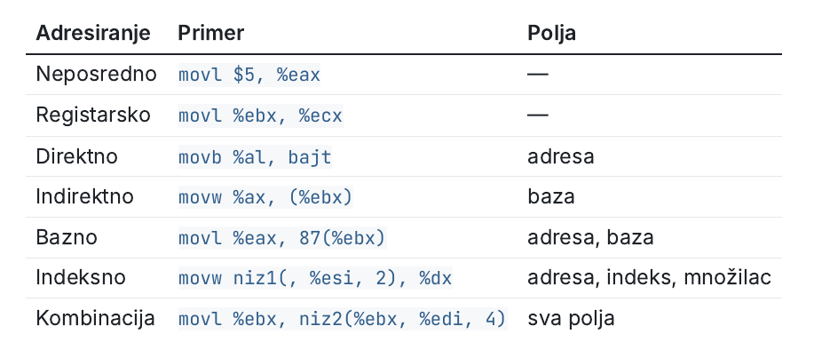 
 - **baza i indeks su registri opšte namene**
#### Indeksno 
 - `movl niz(, %eax, 4), %ebx` 
	  > kreće od adrese niza, pomeri se za %eax * 4 bajta i šta uzme prebaci u %ebx
#### Indirektno 
 - `movl $niz, %eax`
- `addl $8, %eax`
- `movl (%eax), %ebx`
> prebaci adresu niza u %eax, uveća eax za 8 bajtova i onda sa te adrese pročita 4 bajta i upiše u %ebx
#### Kombinacija
- `movl $niz, %ecx`
- `movl $2, %eax`
- `movl (%ecx, %eax, 4), %ebx`
> zadnja linija se prevodi na: kreni od vrednosti koju sadrži ecx, pomeri se za eax * 4 bajtova i upiši vrednost u ebx 
 
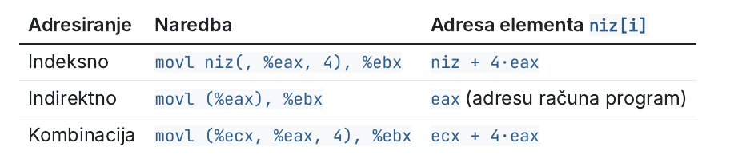  
- indeksno adresiranje radi samo za elemente do 8 bajtova
- za brže zauzimanje i popunjavanje memorije koristi se direktiva fill
> `niz1: .fill br_elem, br_bajt, poč_vredn`
> `niz2: .fill 10, 4, 0`
 
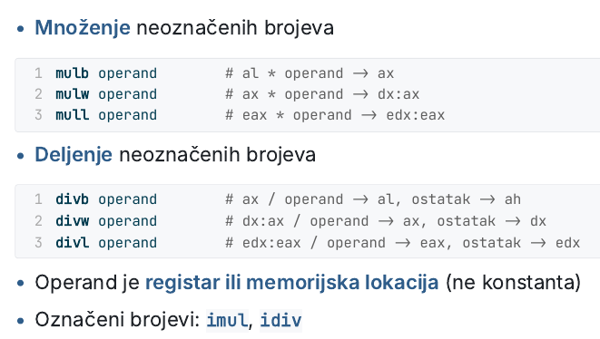 
- operacije množenja koriste registarski par eax:edx za izvršavanje i čuvanje rezultata
- div daje izuzetak ako je delilac 0
- pre divl postaviti edx na 0 
# V4
- string ili niska je niz ASCII znakova od po 1 bajt sa poslednjim znakom "\0" koji označava kraj niza
-  definišu se direktivom .ascii
> `str: .ascii "Neki tekst\0"`
- tačka je brojač lokacija koja pokazuje na prvu slobodnu memorijsku lokaciju
- može se koristiti za izračunavanje dužine niske SAMO ODMAH NAKON DEFINISANJA NISKE
>  `str_len = . - str = 0x10b - 0x100 = 11`
- brojač . radi samo tokom prevođenja programa
- . se mogu odrediti samo dužine već unapred zadatih niski
- "\0" je $0
#### Sistemski pozivi
- omugućavaju pozivanje operacija **operativnog sistema**
- naredba za prekid je  ==int 0x80==
- parametri se prenose preko registra
- različiti pozivi uzimaju različite registre
- u eax se upisuje broj sistemskog poziva
- READ  
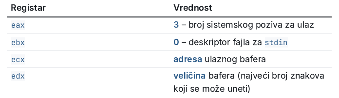  
- rezultat poziva se upisuje u eax
- **poziv read učitava %edx karaktera, read ne dodaje \0 na kraj niske**
- WRITE  
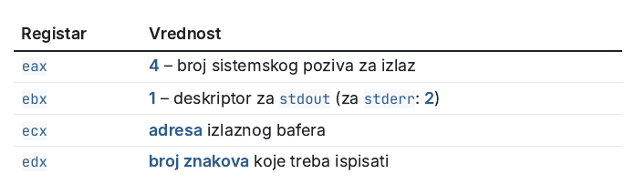  
- eax sadrži broj ispisanih znakova
- write ne prepoznaje \0 - ispisuje onoliko karaktera koja je vrednost edx
- EXIT  
 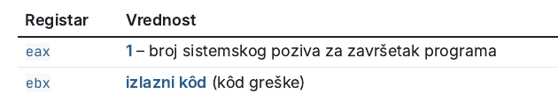  
- naredba `lea` učitava adresu promenljive u registar
- adresa se računa dinamički, tj. u toku izvršavanja
> `lea str, %eax`
#### Česte greške
- prosleđivanje adrese bez $ što daje vrednost na koju pokazuje promenljiva
> `movl str, %eax` VS `movl $str, %eax`
- ne proveravanje vrednosti eax nakon izvršavanja funkcije
- korišćenje registra eax i ax istovremeno
- **UČITAVANJE ILI ISPIS VIŠE KARAKTERA OD POTREBNIH**
# V5
#### Potprogrami
- Potprogrami predstavljaju deo koda koji obavlja određeni zadatak, može se pozivati više puta i pritom sa različitih mesta
- Po završetku izvršavanja potprograma, izvršavanje naredbi nastavlja se od prve naredbe odmah nakon poziva potprograma
- O potprogramima bilo je više reči u [3.5. Potprogrami](https://github.com/TwoCoat/FTN/blob/main/Arhitektura%20ra%C4%8Dunara/Teorija%20za%20parcijalni%20ispit%201.md#35-potprogram)
#### Stek x86 procesora
- O steku je bilo više reči u  [3.7. Stek](https://github.com/TwoCoat/FTN/blob/main/Arhitektura%20ra%C4%8Dunara/Teorija%20za%20parcijalni%20ispit%201.md#37-stek)
> **VAŽNO:** Neophodno je znati da stek raste ka nižim memorijskim adresama, te kada želimo da dodamo promenljivu na stek, mi zapravo pokazivač steka smanjujemo za onoliko prostora koliko je potrebno
- Registar **`esp`** pokazuje na vrh stekea (stack pointer)
- **`push`** - umanjuje esp za `4` bajta, pa na adresu iz `esp` upiše vredn. operanda
- **`pop`** - pročita vrednost sa adrese, koja je sadržava u `esp`, i njenu vrednost upiše u operand; Za kraj poveća `esp` za `4`bajta
> U `32`-bitnom režimo na stek se uvek smeštaju `32`-bitne vrednosti 
#### Poziv potprograma i stek
- **`call labela`** predstavlja poziv određenog potprograma
- na stek ide adresa naredne naredbe; Ova adresa je zapravo povratna adresa naredbe na koju program treba da se vrati po kraju izvršavanja potprograma
- Nakon pozivanja, izvršavanje odmah skače na labelu, tj. početak potprograma
- **`ret`** je naredba koja kada je pozvana učitava vrednost na koju pokazuje trenutno `esp` i pokušava da tu vrednost, koja služi kao povratna adresa, skoči radi daljeg izvršavanja
> Imati na umu da bi `ret` trebalo da se poziva nad vrednostima koje je sama `call` naredba postavila na stek; U suprotnom. velike su šanse da dođe do `segmentation fault`
- `call` i `ret` **podrazumevano** koriste stek, iz tog razloga je neophodno da program ostavi stek onakvim kakvog ga je zatekao
 Potprogramu je neophodno proslediti **argumente** i od njega treba dobiti rezultat
- Programski jezik *C* na `x86` arhitekturi korsti **cdecl** konvenciju:
1. Parametri se stavljalju na stek od poslednjeg ka prvog, tj. kako su parametri navedeni čitajući sa desna ulevo
2. Prvi parametar je odmah iza povratne adrese
3. Kod koji poziva je odgovaran za stavljanje i uklanjanje argumenata
4. Povratna vrednost je u `eax`, odnosno paru registara `edx:eax` ukoliko se radi o `64`-bitnoj
- Ovde je nejasno objašnjeno ko šta radi, te ukratko rečeno:
1. Pozivalac stavlja parametre na stek kako bi im potprogram mogao pristupati; Ti podaci su zapravo argumenti kojim potprogram pristupa; Nakon stavljanja na stek, poziva se potprogram i u istoj naredbi automatski stavlja povratna adresa na stek, nakon čega sledeće instrukcija za izvršavanje se nalazi u potprogramu
2. Zadatak potprograma jeste da prvobitno sačuva vrednost registra **`ebp`** (base pointer) koji sadrži početnu adresu mem. lokacije od koje počinje **stek frejm** programa koji ga je pozvao, kako bi znao kada vrati natrag do koje mem. lokacije sme da vrši promenu podataka i obradu
3. Ukoliko je to neophodno, potprogram može postavljati određene vrednosti na stek, međutim mora ih osloboditi u obrnutom redosledu od postavljanja na stek; Ukoliko je to potrebno, potprogram može zauzeti memoriju za lokalne promenljive, koje na kraju izvršavanja mora oslobodi u obrnutom smeru od zauzimanja; **Ukoliko se koriste registri `ebx, eip, esi` njihova vrednost se prvobitno mora sačuvati na steku, a na kraju izvršavanja ponovo upisati u registre**
4.  Na kraju, oslobađa se stek lokalnih promenljivih, vraćaju se vrednosti u odgovarajuće registre, u `ebp` se upisuje adresa mem. lokacije početka prethodnog frejma, u `esp` se upisuje tačna adresa vrha steka, a potom poziva `ret`  
 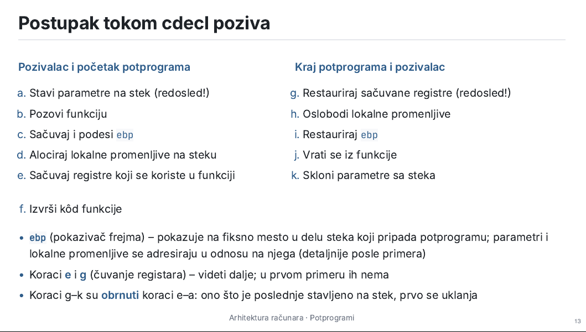 
-  Pogledati primere sa prezentacije *05Potprogrami*
##### Stek frejm
- O frejmu je bilo više reči u  [3.7. Frejm ili okvir](https://github.com/TwoCoat/FTN/blob/main/Arhitektura%20ra%C4%8Dunara/Teorija%20za%20parcijalni%20ispit%201.md#frejm-ili-okvir)
- Stek frejm predstavlja deo steka koji pripada **jednom pozivu** potprograma
- Frejm se sastoji od argumenata, povratne adrese, vrednosti pokazivača frejma i lokalnih promenljivih 
- **Pokazivač frejma**, čiju ulogu ima registar `ebp` pokazuje na određenu tačku frejma, odnosno mem. lokacije; Korišćenjem pokazivača frejma vrlo lako možemo adresirati, te time čitati i upisivati iz i u argumentei lokalne  promenljive
- Memorija na steku se zauzima spuštanjem pokazivača steka naniže za `4` bita 
- Sledeća slika prikazuje adresiranje i pristupanje određenim podacima  
   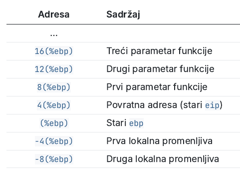  
##### Prenos argumenata po vrednosti i po adresi
- **Po vrednosti** na stek se stavlja kopija vrednosti argumenata; Bilo kakva obrada ovih podataka neće promeniti vrednost izvornih promenljiivih
- **Po adresi** se na stek postavljaju adrese promenljivih, putem kojim im se pristupa i direktno u njih upisuju podaci; Za pristup se koristi indirektno adresiranje, čime izmena menja i vrednost izvornog argumenta
# V6
- `and` primenjuje log. funk. *I* nad odgovarajućim parovima bitova prvog i drugog operanda
- `or` primenjuje log. funk. *ILI* nad odgovarajućim parovima bitova prvog i drugog operanda
- `xor` primenjuje log. funk. *EKSLKUZIVNO ILI* nad odgovarajućim parovima bitova prvog i drugog operanda
- `not` komplementira svaki tako što menja vrednost u suprotnu od postavljene; Ovo je takođe kompl. `1` predstava
- `neg` radi isto što i naredba `not`, pritom na kraju uvećava vredn. operanda za jedan; Ovo je takođe kompl. `2` predstava 
- `test` izvršava istu operaciju nad operandima poput `and`, samo što rezultat ne upisuje u drugi operand, već postavlja zastavice na odgovarajuće vrednosti
> `test` se pretežno koristi za izdavajanje pojedinačnog bita kako bi se proverilo da li je `1` ili `0` proveravanjem zastavice `z`
#### Maskiranje
- **Maska** je posebna vrednost koju ćemo koristiti, uz odgovarajuće naredbe, za promenu određenih bitova, kao i proveru njihovih vrednosti
- Pogledati primere sa prezentacije, dok ćemo ovde opisati neka od ponašanja
- `and` - gde god je  u maski `0`, taj bit će sigurno u rezultatu biti `0` bez obzira na bit originala; U ovoj naredbi, bit sa vrednošću `1` je neutralan za rezultat 
- `or` - gde god je u maski `1`, taj bit će zasigurno u rezultati imati vredn. `1`; Za naredbu `or` neutralni element je `0`
- `xor` - gde god je u maski vredn. bita `1`, u rezultatu će biti obrnuta vredn. od bita originala; Ovde je neutralni element vredn. `0` za bitove maske  
 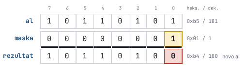  
 - `test` - maska se uvek sastoji od `0` i jedne `1`, kako bi se određeni bit proverio, i to putem provere vrednosti `z` nakon izvršavanja naredbe
#### Negacija
- U dvostrukoj preciznosti negacija u kompl. `2` predstavi iziskuje da se prvobitno komplementiraju niži i viši deo, korišćenjem naredbe `not`
- Potom se prvo niži deo uvećava za `1`
- Nakon toga viši deo se uvećava samo za **vrednost prenosa**, tj `carry` zastavice  
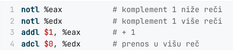 
#### Naredbe za pomeranje
- Pomeranje za `n` mesta ulevo ili udesno predstavlja množenje sa 2^n ili deljenje sa 2^n  
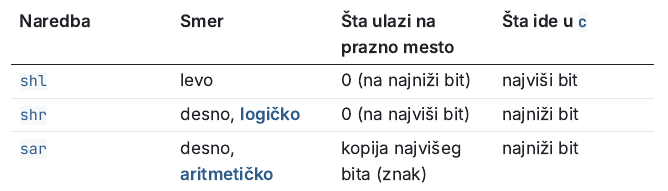  
- ukoliko je neophodno sačuvati znak operanda, koristi se naredba `sar`
- `shl` (shift left) - pomera sve bitove za jedno mesto ulevo, najznačajniji bit odlazi u `carry`; Na mesto najmanje značajnog dolazi `0` 
  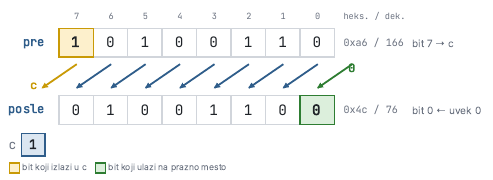  
 - `shr` (shift right) - kontra od `shl`, svi bitovi za jedno mesto udesno, na mesto najznačajnijeg dolazi `0`, vredn. najmanje značajnog bita odlazi u `carry` 
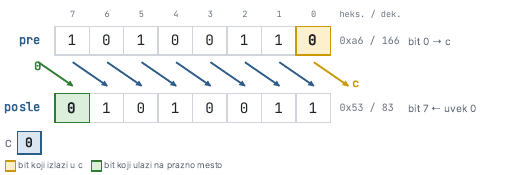  
 - `sar` (shift arithmetical right) - ne menja vredn. najznačajnijeg bita, njegovu vrednost pomera udesno, najmanje značajan odlazi u `carry`  
   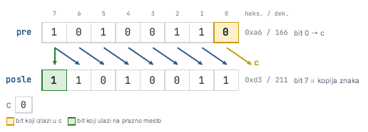 
#### Naredbe za rotiranje
- Kod rotiranja se nijedan bit ne gubi - bit koji odlazi u `carry` upisuje se sa druge strane  
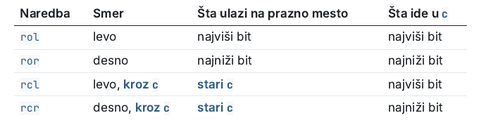  
- `rol` (rotate left) - svi bitovi se pomeraju ulevo, najznačajniji bit odlazi u `carry`, potom se upisuje na mesto najmanje značajnog bita  
 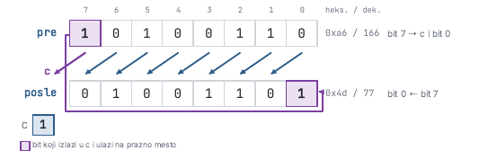  
 - `ror` (rotate right) - svi bitovi se pomeraju udesno, najmanje značajan odlazi u `carry`, te se vrednost upisuje na najviše značajan bit  
 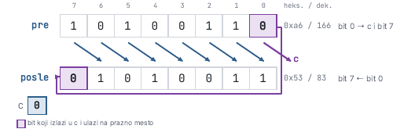  
 - `rcl` (rotate carry left) - radi isto što i `rol`, samo što na mesto najmanje značajnog upisuje **staru vredn. `carry` zastavice**, a potom upisuje u `carry` vrednost najznačajnijeg bita pre rotacije
 - `rcr` (rotate carry right) - radi isto što i `ror`, samo na mesto najznačajnijeg upisuje **staru vredn.  `carry` zastavice**, a potom vredn. najmanje značajnog bita upisuje u `carry`
#### Pomeranje i rotiranje u dvostrukoj preciznosti
 
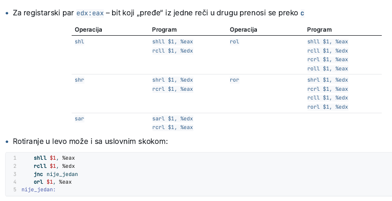
 
#### Kotrolna suma i paritet
- Pri prenosu podataka moguće je doći do greške, te je neophodno nekako proveriti da li su dobijeni podaci ispravni
- Za potrebe provere koristi se **kontrolna suma** (checksum)
#### Horizontalni paritet
- **Paritet** - govori nam da li je broj jedinica u podatku paran  ili neparan
- Bit pariteta se obično smešta na najviše mesto – podaci tada imaju bit manje, a svaki bajt ima paran broj jedinica. 
> Nedostatak: paran broj promenjenih bita se ne otkriva.
- Neparan broj jedinica -> `1` bit pariteta
- Paran broj jedinica -> `0` bit pariteta  
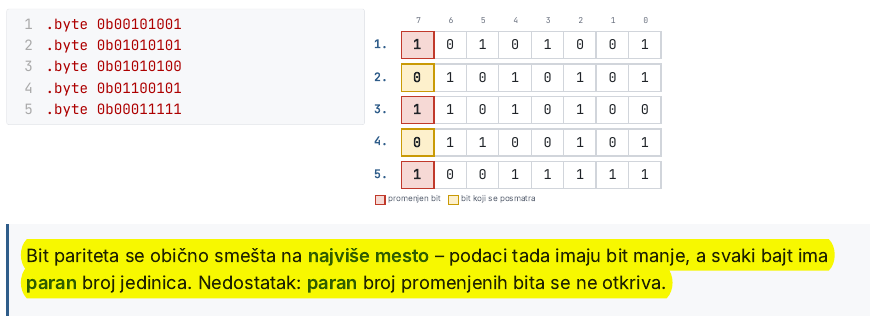
 
#### Vertikalni paritet
- Koristi se kontrola suma za podatke **kao celinu**
- Broje se jedinice na istom indeksu u svim podacima
- Bit pariteta za tu kolonu smešta se u bit kontrolne sume sa istim indeksom  
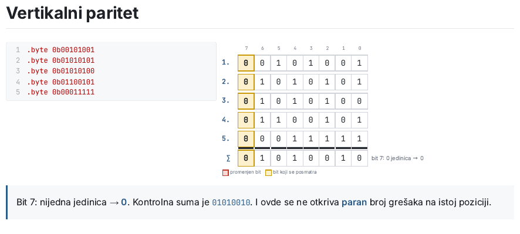  
- **Ogromni nedostatak** kod ovakih načina provere jeste paran broj promenjenih bita, koji se neće otkriti
